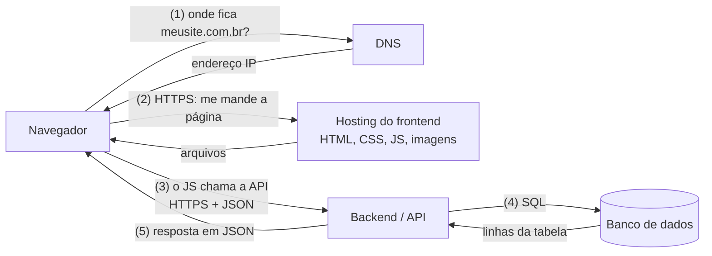

# Apostila do Workshop de IA · SONORA

**Workshop presencial · 20/10/2026 · Instrutor: Roberto**

- Projeto A (pronto): **SONORA**, marca fictícia de headphones premium.
  - Código: <https://github.com/Movits/sonora>
  - Site no ar: <https://movits.github.io/sonora/>
- Projeto B (ao vivo): um site com o tema escolhido pela turma, feito do zero com a mesma tecnologia.

---

## Como usar esta apostila

- **Durante a aula:** acompanhe o capítulo que o Roberto citar. Você não precisa ler tudo agora.
- **Depois da aula:** leia na ordem. Cada capítulo tem uma analogia, um exemplo e um mini-exercício. As respostas estão no fim.
- **Convenções:**
  - `texto assim` é algo que você digita no terminal ou num arquivo.
  - "Conferir na sua versão" quer dizer que aquilo pode mudar entre versões do Claude Code.
  - Preços e limites têm data (19/10/2026). Eles mudam. Confira antes de contratar.
- **Termos em inglês:** a área usa muitos. Aqui eles aparecem em inglês, com a explicação em português ao lado.
- **Prompts prontos:** [prompts/README.md](prompts/README.md). **Termos:** [glossario.md](glossario.md).

### O que instalar para refazer em casa

| Ferramenta | Para que serve | Onde baixar | Como conferir |
|---|---|---|---|
| Node.js 22 ou mais novo | roda JavaScript fora do navegador e traz o `npm` | <https://nodejs.org> | `node --version` |
| Git | guarda o histórico do código | <https://git-scm.com> | `git --version` |
| Google Chrome | navegador com boas ferramentas de desenvolvedor | <https://www.google.com/chrome/> | abrir o Chrome |
| VS Code (editor) | onde você lê e edita os arquivos | <https://code.visualstudio.com> | abrir o VS Code |
| Conta no GitHub | onde o código fica na nuvem | <https://github.com> | entrar no site |
| Conta no Claude, com Claude Code | o assistente que trabalha no seu projeto | app Claude Desktop (aba Code) ou a CLI | ver capítulo 8 |
| GitHub CLI (`gh`), opcional | usar o GitHub pelo terminal | <https://cli.github.com> | `gh --version` |

### Sumário

1. Como o computador organiza as coisas
2. HTML, CSS e JavaScript
3. Anatomia de um projeto Vite
4. Como a web funciona
5. Inteligência artificial sem mistério
6. Escrevendo bons prompts
7. Pensamento crítico: a IA erra
8. Claude Code na prática
9. Tokens, contexto e compactação
10. Onde a informação vive
11. Skills, MCP e conectores
12. Git e GitHub
13. Testes e debugging
14. Banco de dados e segurança básica
15. Custos e limites
16. Próximos passos e referências
17. Respostas dos exercícios

---

## 1. Como o computador organiza as coisas

### Analogia

Pense no computador como um **prédio de escritórios**.

- O **sistema operacional** (Windows, macOS, Linux) é a administração do prédio. Ele decide quem usa o elevador, quais salas estão livres e onde fica cada coisa.
- As **pastas** são as salas e as gavetas.
- Os **arquivos** são os documentos dentro das gavetas.
- A **extensão** é a etiqueta que diz o tipo do documento (`.html`, `.css`, `.png`).
- O **caminho** é o endereço completo: prédio, andar, sala, gaveta, documento.

### Vocabulário

| Termo | O que é | Exemplo |
|---|---|---|
| Sistema operacional | o programa principal, que controla o computador e roda os outros | Windows 11, macOS |
| Pasta (diretório, *directory*) | um lugar que guarda arquivos e outras pastas | `src/` |
| Arquivo (*file*) | um documento com conteúdo | `index.html` |
| Extensão | o final do nome, que indica o tipo | `.js` = JavaScript, `.md` = Markdown |
| Caminho absoluto | o endereço completo, a partir da raiz do disco | `C:\Users\ana\projetos\meu-site\index.html` |
| Caminho relativo | o endereço a partir de onde você está | `src/main.js`, `../styles/base.css` |
| Terminal | a janela onde você digita comandos em vez de clicar | PowerShell, Git Bash, Terminal do Mac |
| Comando | uma ordem para um programa | `npm install` |
| Editor | o programa onde você lê e escreve código | VS Code |
| Projeto | a pasta com tudo de um site ou app | `sonora/` |
| Dependência | código de outra pessoa que o seu projeto precisa para funcionar | `gsap` |
| Biblioteca (*library*) | uma caixa de ferramentas: você chama quando quer | GSAP (animação) |
| Framework | uma planta da casa: ele define a estrutura e chama o seu código | React, Next.js |

**Biblioteca x framework, em uma frase:** você chama a biblioteca; o framework chama você.

O **Vite** não é nem uma coisa nem outra. Ele é uma ferramenta de desenvolvimento (*build tool*): liga um servidor local enquanto você trabalha e empacota o site para publicar.

### Extensões e arquivos escondidos

- O Windows esconde as extensões por padrão. Para mostrar: Explorador de Arquivos → **Exibir** → **Mostrar** → **Extensões de nomes de arquivos**.
- Arquivos que começam com ponto (`.gitignore`, `.env`, `.github/`) ficam escondidos no Mac e no Linux. No Finder do Mac, `Cmd + Shift + .` mostra e esconde.

### Caminhos: absoluto e relativo

```text
Absoluto (Windows):  C:\Users\ana\projetos\meu-site\src\main.js
Absoluto (Mac):      /Users/ana/projetos/meu-site/src/main.js
Relativo:            src/main.js        (a partir da pasta meu-site)
```

- `.` quer dizer "a pasta onde estou".
- `..` quer dizer "a pasta de cima".
- De `src/sections/hero.js`, o arquivo `src/styles/base.css` fica em `../styles/base.css`: sobe uma pasta (de `sections` para `src`) e entra em `styles`.

Dentro de um projeto, prefira caminhos **relativos**. Um caminho como `C:\Users\ana\...` só existe no computador da Ana e quebra no de qualquer outra pessoa.

### Terminal e comandos

Um comando tem partes:

```bash
npm install gsap
# npm     -> o programa
# install -> o que ele deve fazer (subcomando)
# gsap    -> sobre o que (argumento)

git commit -m "feat: novo título"
# -m      -> uma opção (flag); aqui, a mensagem do commit
```

Comandos básicos de navegação (funcionam no PowerShell, no Git Bash e no Terminal do Mac):

| Comando | O que faz |
|---|---|
| `pwd` | mostra em que pasta você está |
| `ls` | lista o que tem na pasta |
| `cd nome-da-pasta` | entra numa pasta |
| `cd ..` | volta uma pasta |
| `mkdir nova-pasta` | cria uma pasta |
| `code .` | abre a pasta atual no VS Code (se o VS Code estiver no PATH) |

### A árvore real do SONORA

Esta é a estrutura do repositório do Projeto A (conferida em 19/10, depois da PR #1). A versão mais atual está no GitHub.

```text
sonora/
├── .claude/
│   ├── settings.json           configuração do Claude Code no projeto: modelo, effort, modo e permissões
│   ├── launch.json             servidores de pré-visualização do app (dev e preview)
│   └── skills/
│       └── review-landing/     skill do projeto (capítulo 11)
│           ├── SKILL.md        a receita da revisão
│           ├── README.md       explicação da skill para pessoas
│           └── scripts/
│               └── checar.mjs  abre o site no Chrome e mede (console, imagens, peso, foco...)
├── .github/
│   ├── workflows/              automações do GitHub Actions: ci.yml (testes) e pages.yml (deploy no Pages)
│   └── pull_request_template.md  modelo da descrição de toda PR
├── midia/
│   └── explosao.mp4            o vídeo de onde saíram os quadros do exploded view
├── node_modules/               GERADO pelo npm install (não vai para o Git)
├── public/                     arquivos servidos como estão
│   ├── frames/                 quadros .webp do exploded view: 121 em desktop/ e 60 em mobile/
│   └── img/                    imagens do site
├── scripts/
│   ├── extrair-quadros.mjs     extrai os quadros do vídeo com o ffmpeg (npm run frames)
│   └── capturas.mjs            tira capturas de tela do site em três larguras
├── src/                        o código que você escreve
│   ├── lib/                    funções de apoio
│   ├── sections/               um arquivo .js por seção da página
│   ├── styles/                 os arquivos .css
│   └── main.js                 ponto de partida do JavaScript
├── tests/                      testes automáticos com Playwright
│   ├── site.spec.js            o site abre sem erros, cena, imagens, reserva, celular, movimento reduzido
│   └── checar.spec.js          a skill /review-landing roda até o fim contra o site
├── workshop/                   esta apostila e os prompts da aula
├── .env.example                modelo do .env, sem valores
├── .gitignore                  o que o Git ignora
├── .gitattributes              regras de fim de linha e de arquivos binários
├── index.html                  a página (estrutura e textos)
├── package.json                lista de dependências e de comandos
├── package-lock.json           GERADO: versões exatas instaladas (vai para o Git)
├── playwright.config.js        configuração dos testes
├── vite.config.js              configuração do Vite (base: '/sonora/')
├── CLAUDE.md                   instruções para o Claude Code
├── LICENSE                     licença MIT
└── README.md                   explicação do projeto para pessoas
```

As fontes do SONORA (Unbounded e Onest) não ficam numa pasta solta: vêm dos pacotes `@fontsource`, instalados pelo npm, e o Vite as empacota junto com o site. O efeito é o mesmo de uma fonte local: nada é baixado da internet quando a página abre.

### O que editar, o que é gerado e o que não versionar

"Versionar" é guardar no Git (capítulo 12).

| Categoria | Itens | Regra |
|---|---|---|
| Você edita | `index.html`, `src/`, `public/img`, `tests/`, `CLAUDE.md`, `README.md` | é o seu trabalho; vai para o Git |
| Gerado, mas versionado | `package-lock.json`, `public/frames/` | não edite à mão; **vai** para o Git |
| Gerado e não versionado | `node_modules/` (criado pelo `npm install`), `dist/` (criado pelo `npm run build`) | recria com um comando; fica fora do Git |
| Segredo, nunca versionar | `.env` | fica só no seu computador (capítulo 14) |

Atenção ao `package-lock.json`. Ele é gerado, mas **deve** ir para o Git. É ele que garante que todo mundo instala exatamente as mesmas versões.

Os quadros de `public/frames/` também são gerados (extraídos de um vídeo), mas vão para o Git, porque o site publicado precisa deles.

### Mini-exercício 1

1. Qual destes caminhos é absoluto e qual é relativo? `C:\Users\ana\projetos\meu-site\index.html` e `src/main.js`.
2. Você está editando `src/sections/hero.js` e quer apontar para `src/lib/util.js`. Qual é o caminho relativo?
3. Classifique cada item em "eu edito", "gerado e versionado", "gerado e fora do Git" ou "segredo": `index.html`, `node_modules/`, `dist/`, `package-lock.json`, `.env`, `src/main.js`.
4. Um colega apagou o `package-lock.json` "porque era gerado". Por que isso é um problema?

---

## 2. HTML, CSS e JavaScript

### Analogia: a casa

| Linguagem | Na casa | No site |
|---|---|---|
| **HTML** | a estrutura: paredes, cômodos, portas | títulos, parágrafos, botões, imagens |
| **CSS** | a pintura e a decoração | cores, fontes, espaçamentos, layout |
| **JavaScript** | a eletricidade: interruptor, campainha | o que acontece ao clicar, rolar, carregar |

Uma casa sem pintura funciona, mas é feia. Uma casa sem eletricidade fica parada. Uma casa sem estrutura não existe.

### Um exemplo com as três juntas

**HTML** (estrutura), em `index.html`:

```html
<section class="hero">
  <h1>Som que você sente</h1>
  <p>Headphones SONORA</p>
  <button class="botao" id="comprar">Quero o meu</button>
  <p id="aviso" hidden></p>
</section>
```

**CSS** (aparência), num arquivo de `src/styles/`:

```css
:root {
  --cor-destaque: #c8a96a;   /* variável: muda aqui, muda em todo lugar */
}

.botao {
  background: var(--cor-destaque);
  color: #111;
  padding: 12px 24px;        /* espaço por dentro */
  border-radius: 999px;      /* cantos arredondados */
}
```

**JavaScript** (comportamento), em `src/main.js` ou num arquivo de `src/sections/`:

```js
const botao = document.querySelector('#comprar');
const aviso = document.querySelector('#aviso');

botao.addEventListener('click', () => {
  aviso.hidden = false;
  aviso.textContent = 'Obrigado! Avisaremos quando abrir a pré-venda.';
});
```

### Onde procurar cada coisa no SONORA

| Quero mudar... | Procure em |
|---|---|
| um texto, a ordem das seções, uma imagem nova | `index.html` (se o texto não estiver lá, em `src/sections/`) |
| cor, fonte, tamanho, espaçamento, layout no celular | `src/styles/` |
| animação, clique, comportamento de uma seção | `src/sections/` |
| o que carrega primeiro | `src/main.js` |
| o arquivo de imagem em si | `public/img/` |

**Dica que vale ouro:** use a busca do VS Code em todos os arquivos, com `Ctrl + Shift + F` (no Mac, `Cmd + Shift + F`). Digite o texto que você vê na tela e o editor mostra em que arquivo ele está.

**Outra dica:** no Chrome, clique com o botão direito no elemento e escolha **Inspecionar**. O DevTools mostra a classe do elemento e em que arquivo CSS está o estilo dele.

### Como funciona o exploded view do SONORA (ideia simplificada)

A animação principal mostra o fone "se desmontando" conforme você rola a página. Ela foi feita assim:

1. Um vídeo curto foi gerado no Higgsfield: o fone montado vira o fone explodido.
2. O `ffmpeg` (programa de vídeo) extraiu cerca de 120 quadros em WebP para `public/frames/`.
3. Um `<canvas>` fica fixo na tela (*pinned*) enquanto você rola.
4. O ScrollTrigger, do GSAP, liga a rolagem ao número do quadro (*scrub*). Rolou para baixo, avança o quadro; rolou para cima, volta.
5. Quem ativou "reduzir movimento" no sistema (`prefers-reduced-motion`) vê uma imagem estática.

A ideia em código (o código real do SONORA é mais completo):

```js
import { gsap } from 'gsap';
import { ScrollTrigger } from 'gsap/ScrollTrigger';
gsap.registerPlugin(ScrollTrigger);

const TOTAL = 120;
const estado = { quadro: 0 };

gsap.to(estado, {
  quadro: TOTAL - 1,
  snap: 'quadro',          // só números inteiros
  ease: 'none',
  scrollTrigger: {
    trigger: '#explodido', // a seção
    start: 'top top',
    end: '+=3000',         // dura 3000 px de rolagem
    scrub: true,           // segue o dedo/mouse
    pin: true,             // fixa a seção na tela
  },
  onUpdate: () => desenhar(estado.quadro), // desenha a imagem certa no canvas
});
```

### Mini-exercício 2

Para cada mudança, diga **em que arquivo você procuraria** e **o que mudaria**. Pense antes de olhar as respostas.

1. Mudar o título principal da página.
2. Trocar a cor de um botão.
3. Adicionar uma imagem nova numa seção.
4. Criar uma interação: ao clicar num botão, aparece uma mensagem.
5. Aumentar ou diminuir o espaço entre duas seções.
6. Corrigir um layout no celular: três cartões lado a lado ficam espremidos numa tela estreita.

---

## 3. Anatomia de um projeto Vite

### Analogia: a cozinha de um restaurante

| Arquivo ou pasta | Na cozinha |
|---|---|
| `index.html` | a porta de entrada e o cardápio |
| `package.json` | a lista de compras e o caderno de comandos da cozinha |
| `package-lock.json` | a nota fiscal, com marca e lote exatos de cada ingrediente |
| `node_modules/` | a despensa cheia, montada a partir da lista |
| `src/` | a bancada onde a comida é preparada |
| `public/` | o que vai para a mesa como está (água engarrafada) |
| `dist/` | os pratos prontos, embalados para entrega |
| `.gitignore` | a lista do que não vai no caminhão de mudança |
| `.env` | o cofre |
| `.env.example` | a etiqueta do cofre: diz o que deveria ter dentro, sem o conteúdo |
| `README.md` | a placa na porta, que explica o restaurante para pessoas |
| `CLAUDE.md` | o manual do cozinheiro assistente (o Claude) |

### Cada peça, em detalhe

| Item | O que é | Quem mexe | Vai para o Git? |
|---|---|---|---|
| `index.html` | a página. O Vite começa por ela e ela carrega `src/main.js` | você | sim |
| `package.json` | nome do projeto, dependências e atalhos de comando (`scripts`) | você e o `npm install` | sim |
| `package-lock.json` | as versões exatas de tudo o que foi instalado | só o `npm` | sim |
| `src/` | o código-fonte. O Vite processa, junta e otimiza | você | sim |
| `src/main.js` | o primeiro JavaScript a rodar; importa o CSS e as seções | você | sim |
| arquivos CSS | a aparência. No SONORA ficam em `src/styles/` | você | sim |
| `public/` | arquivos copiados sem mudança (imagens, fontes, quadros) | você | sim |
| `node_modules/` | as dependências baixadas. Pode ter milhares de arquivos | só o `npm` | **não** |
| `dist/` | o site pronto para publicar, criado pelo `npm run build` | só o Vite | **não** |
| `.gitignore` | a lista do que o Git deve ignorar | você | sim |
| `.env` | variáveis secretas (chaves, senhas) | você | **nunca** |
| `.env.example` | modelo do `.env`, com os nomes das variáveis e sem os valores | você | sim |
| `README.md` | o que é o projeto, como instalar, como rodar | você | sim |
| `CLAUDE.md` | regras e contexto que o Claude Code lê em toda sessão | você (e o `/init`) | sim |

O SONORA é um site estático e não precisa de segredos. Se um dia precisar, o `.env.example` mostra quais variáveis existem.

### `src/` x `public/`

- O que está em `src/` é **processado**. O Vite junta os arquivos, otimiza e troca os nomes (por exemplo, `index-a1b2c3.js`).
- O que está em `public/` é **copiado como está**. Use para arquivos que precisam manter o nome, como os cerca de 120 quadros do exploded view.

### O `package.json` real do SONORA

```json
{
  "name": "sonora",
  "private": true,
  "version": "1.0.0",
  "type": "module",
  "description": "SONORA — site demonstrativo de uma marca fictícia de headphones premium (Workshop de IA WRW).",
  "scripts": {
    "dev": "vite",
    "build": "vite build",
    "preview": "vite preview",
    "test": "playwright test",
    "frames": "node scripts/extrair-quadros.mjs"
  },
  "dependencies": {
    "@fontsource/onest": "^5.3.1",
    "@fontsource/unbounded": "^5.3.0",
    "gsap": "^3.15.0"
  },
  "devDependencies": {
    "@playwright/test": "^1.64.1",
    "vite": "^8.3.4"
  },
  "license": "MIT"
}
```

Como ler:

- **`scripts`** são atalhos. `npm run dev` roda `vite`; `npm test` roda os testes do Playwright.
- **`dependencies`** vão junto para o site. O GSAP precisa estar no site para animar, e os pacotes `@fontsource` trazem as fontes.
- **`frames`** é um script do próprio projeto: `npm run frames` usa o ffmpeg para extrair os quadros do vídeo.
- **`devDependencies`** só ajudam a desenvolver e testar. O Vite e o Playwright não vão para o site publicado.
- **`^3.15.0`** quer dizer "a versão 3.15.0 ou uma 3.x mais nova e compatível". A versão exata instalada fica no `package-lock.json`.

### Os comandos do dia a dia

| Comando | O que faz | Quando usar |
|---|---|---|
| `npm install` | lê o `package.json` e monta o `node_modules/` | logo depois de clonar ou criar um projeto |
| `npm install gsap` | instala uma dependência nova e anota no `package.json` | quando precisa de uma biblioteca |
| `npm ci` | instala exatamente o que está no `package-lock.json` | no CI (GitHub Actions) |
| `npm run dev` | liga o servidor local, normalmente em <http://localhost:5173> | enquanto trabalha; recarrega sozinho ao salvar |
| `npm run build` | cria a pasta `dist/` com o site otimizado | antes de publicar, para conferir que não quebra |
| `npm run preview` | serve a pasta `dist/` localmente (normalmente na porta 4173) | para ver o site "como vai ficar no ar" |
| `npm test` | roda os testes | antes de abrir uma PR |

Para desligar o servidor local, volte ao terminal e aperte `Ctrl + C`.

No SONORA, os endereços terminam em `/sonora/` (`http://localhost:5173/sonora/` e `http://localhost:4173/sonora/`), porque o `vite.config.js` usa `base: '/sonora/'`, o mesmo caminho do site publicado. Use sempre o endereço que o terminal mostrar.

### Mão na massa: criar o Projeto B

Na aula, para não esperar a instalação, o Roberto parte de uma pasta base pronta, com a mesma estrutura: Vite, GSAP, testes e Git já instalados, sem nenhum conteúdo. Em casa, ou no seu notebook durante a aula, você cria o projeto do zero com os passos abaixo e adapta para a sua ideia. Cada passo leva de 5 a 10 minutos.

**Passo 1 (5 min): criar o projeto.**

```bash
npm create vite@latest meu-site -- --template vanilla
cd meu-site
npm install
npm install gsap
git init -b main
npm run dev
```

Se o assistente do Vite fizer alguma pergunta, aceite o padrão. O `git init -b main` cria o repositório já com a branch `main`: sem o `-b main`, muitos computadores criam a branch `master`, e o deploy no GitHub Pages espera a `main`. Abra o endereço que aparecer no terminal (normalmente <http://localhost:5173>).

O modelo `vanilla` cria mais ou menos estes arquivos (os nomes podem variar com a versão do Vite):

```text
meu-site/
├── public/            um ícone de exemplo
├── src/
│   ├── main.js        o JavaScript inicial
│   ├── style.css      o CSS inicial
│   └── counter.js     um exemplo de botão contador (pode apagar)
├── .gitignore
├── index.html
└── package.json
```

**Passo 2 (5 min): abrir no Claude Code e criar o `CLAUDE.md`.** No app Claude Desktop, aba Code, escolha a pasta `meu-site`. Use o modo **Manual** ou **Accept edits** e rode `/init`, ou peça um `CLAUDE.md` curto (modelo no capítulo 8).

**Passo 3 (10 min): primeira seção.** Use a estrutura de prompt do capítulo 6 para pedir o hero (a seção de abertura) com o tema da turma. Confira no navegador.

**Passo 4 (10 min): primeira animação.** Peça uma entrada suave com GSAP e uma animação ligada à rolagem com ScrollTrigger, respeitando `prefers-reduced-motion`.

**Passo 5 (5 a 10 min): revisar e guardar.** Leia o que mudou (`/diff` ou `git diff`), rode `npm run build` e faça o primeiro commit (capítulo 12).

### Mini-exercício 3

1. Você clonou o SONORA, rodou `npm run dev` e apareceu um erro dizendo que o `vite` não foi encontrado. Que comando faltou?
2. Em que pasta você colocaria um arquivo de fonte (`.woff2`)? Por quê?
3. Qual é a diferença entre `dependencies` e `devDependencies`? Dê um exemplo de cada no SONORA.
4. A pasta `dist/` vai para o Git? Quem cria essa pasta no deploy?

---

## 4. Como a web funciona

### Analogia: o restaurante

| Na web | No restaurante |
|---|---|
| Navegador (*browser*) / cliente | você, sentado à mesa |
| HTTP / HTTPS | o garçom que leva pedidos e traz pratos. HTTPS é o garçom com envelope lacrado |
| Frontend | o salão e o cardápio: o que você vê e toca |
| Backend / servidor | a cozinha: prepara o que foi pedido |
| API | o balcão de pedidos, com regras de como pedir |
| JSON | a comanda escrita num formato que todos entendem |
| Banco de dados | a despensa com fichas de estoque |
| Domínio | o nome do restaurante na fachada |
| DNS | a lista telefônica: troca o nome pelo endereço de verdade |
| Hosting | o aluguel do ponto |
| Deploy | abrir as portas: pôr a versão nova no ar |

### Vocabulário

| Termo | O que é |
|---|---|
| Cliente | quem pede. Na web, quase sempre o navegador |
| Servidor | o computador que responde aos pedidos |
| Navegador (*browser*) | o programa que baixa e mostra sites (Chrome, Safari, Edge) |
| HTTP | o protocolo, ou seja, as regras da conversa entre cliente e servidor |
| HTTPS | HTTP com criptografia: ninguém no caminho lê nem altera |
| API | uma "porta de serviço" que um programa oferece para outros programas |
| JSON | um formato de texto para trocar dados |
| Frontend | a parte que roda no navegador: HTML, CSS e JS |
| Backend | a parte que roda no servidor: regras, contas, acesso ao banco |
| Banco de dados | onde os dados ficam guardados de forma organizada |
| SQL | a linguagem para conversar com bancos de dados relacionais |
| CRUD | as quatro operações básicas: *Create, Read, Update, Delete* (criar, ler, atualizar, apagar) |
| Autenticação | provar **quem você é** (login e senha) |
| Autorização | o que você **pode fazer** depois de entrar |
| Deploy | publicar uma versão nova |
| Hosting (hospedagem) | o serviço que mantém o site no ar |
| Domínio | o nome do site, como `meusite.com.br` |
| DNS | o sistema que traduz o domínio no endereço numérico (IP) do servidor |

**Autenticação x autorização:** o crachá na portaria prova quem você é (autenticação). As salas que esse crachá abre são a autorização.

### O caminho de um pedido



A mesma coisa em texto:

```text
Navegador ──(1. DNS)──> descobre o endereço do servidor
Navegador ──(2. HTTPS)──> Hosting: baixa HTML, CSS, JS e imagens (o frontend)
Frontend (rodando no navegador) ──(3. HTTPS + JSON)──> Backend / API
Backend ──(4. SQL)──> Banco de dados ──> devolve as linhas
Backend ──(5. JSON)──> Frontend ──> a página mostra o resultado
```

**O SONORA para no passo 2.** Ele é um site **estático**: só arquivos prontos, sem backend e sem banco. O GitHub Pages entrega os arquivos e pronto. O Projeto B também é assim.

Um app com login e dados (pedidos, usuários, estoque) usa os passos 3 a 5.

### JSON: um exemplo

Um pedido de hamburgueria, do jeito que uma API mandaria:

```json
{
  "id": 42,
  "cliente": "Ana",
  "itens": [
    { "nome": "Smash duplo", "quantidade": 2 },
    { "nome": "Batata rústica", "quantidade": 1 }
  ],
  "status": "em preparo",
  "pago": true
}
```

### Métodos HTTP e códigos de resposta

| Método | Para que serve | CRUD |
|---|---|---|
| `GET` | pedir dados | Read (ler) |
| `POST` | criar algo | Create (criar) |
| `PUT` / `PATCH` | alterar algo | Update (atualizar) |
| `DELETE` | apagar algo | Delete (apagar) |

| Código | Quer dizer |
|---|---|
| 200 | deu certo |
| 404 | não encontrado (caminho errado, arquivo que não existe) |
| 401 | você não está autenticado |
| 403 | você está autenticado, mas não tem autorização |
| 500 | erro dentro do servidor |

### Como o SONORA vai ao ar

```text
merge na main ──> GitHub Actions roda o build ──> GitHub Pages publica ──> https://movits.github.io/sonora/
```

O endereço `movits.github.io` é um subdomínio grátis do GitHub. Para usar um domínio próprio (`sonora.com.br`), você compra o domínio e configura o DNS para apontar para o GitHub Pages.

### Mini-exercício 4

1. Ponha em ordem: (a) o backend consulta o banco; (b) o navegador pergunta ao DNS o endereço; (c) o navegador baixa HTML, CSS e JS; (d) a página mostra o resultado; (e) o JS do frontend chama a API.
2. Autenticação ou autorização? (a) Entrar com e-mail e senha. (b) Só o gerente pode apagar itens do cardápio.
3. Você abriu `https://meusite.com/promo` e viu "404". O que isso indica?
4. O SONORA precisa de banco de dados? Por quê?

---

## 5. Inteligência artificial sem mistério

### Analogia

Um **LLM** é como um estudante que leu uma biblioteca enorme e ficou muito bom em continuar textos. Ele prevê, pedaço por pedaço, qual é a continuação mais provável.

- Ele não consulta a biblioteca na hora da prova. Ele lembra do que aprendeu.
- Ele só "vê" o que está na mesa dele agora: a conversa e os arquivos que você mostrou. Isso é o **contexto**.
- Se você der ferramentas (ler arquivos, rodar comandos, buscar na web), ele vira um **agente**: além de responder, consegue agir.

### Vocabulário

| Termo | O que é |
|---|---|
| IA (inteligência artificial) | programas que fazem tarefas que pareciam exigir inteligência humana |
| IA generativa | IA que **cria** conteúdo novo: texto, código, imagem, vídeo |
| LLM (*Large Language Model*) | modelo de linguagem grande, treinado com muito texto. Claude é um LLM |
| Token | o pedaço de texto que o modelo lê e escreve. Uma palavra pode virar um ou mais tokens |
| Contexto | tudo o que o modelo está considerando agora: conversa, arquivos lidos, resultados de comandos, instruções |
| Janela de contexto | o tamanho máximo do contexto, medido em tokens |
| Inferência | o momento em que o modelo roda e gera a resposta |
| Alucinação | quando o modelo gera algo que parece certo, mas é falso: um comando que não existe, um link inventado |
| Effort | quanto o modelo se esforça: quanto pensa e trabalha antes de responder |
| Temperatura | um ajuste de aleatoriedade na escolha das palavras. No Claude Code não se ajusta |
| Agente | um modelo que usa ferramentas em ciclo: pensa, age, observa o resultado, repete |
| Ferramenta (*tool*) | uma ação que o agente pode executar: ler arquivo, editar, rodar comando |
| Skill | um "procedimento" escrito em Markdown que ensina o agente a fazer uma tarefa de um jeito |
| Conector | uma integração pronta com um serviço (Notion, Google Drive), ligada com poucos cliques |
| MCP (*Model Context Protocol*) | um padrão aberto para ligar ferramentas e dados externos a um modelo. É a "tomada padrão" |

### Effort não é temperatura

São coisas diferentes. Muita gente confunde.

| | Effort | Temperatura |
|---|---|---|
| O que controla | a profundidade: quanto o modelo pensa e trabalha | a aleatoriedade na escolha das palavras |
| Analogia | quanto tempo o estudante gasta na prova | o quanto ele "arrisca" respostas diferentes |
| No Claude Code | ajustável: `low`, `medium`, `high`, `xhigh`, `max` | **não** é ajustável |
| Efeito prático | mais effort: mais cuidado, mais demora, mais tokens | não se aplica ao Claude Code |

Nos modelos atuais da Anthropic, mandar pela API uma temperatura fora do padrão devolve erro. Por isso, aqui, temperatura é só um conceito. O botão que importa é o effort.

### Como um agente trabalha

```text
Você pede ──> o agente pensa ──> usa uma ferramenta (lê um arquivo, roda um comando)
          ──> olha o resultado ──> decide o próximo passo ──> ... ──> responde
```

O Claude Code é um agente. Ele lê os arquivos do seu projeto, roda comandos e edita código, sempre dentro das permissões que você der (capítulo 8).

### Por que a IA alucina

O modelo gera o texto mais **plausível**, não necessariamente o **verdadeiro**. Ele não tem um alarme interno de "isso eu não sei". Por isso ele pode inventar com a mesma confiança com que acerta. A defesa é verificar (capítulo 7).

### Mini-exercício 5

Verdadeiro ou falso?

1. Aumentar o effort deixa o modelo mais aleatório e criativo.
2. Um token é sempre exatamente uma palavra.
3. Uma skill é um modelo de IA novo, treinado para uma tarefa.
4. MCP é um jeito padronizado de ligar ferramentas e dados externos a um modelo.
5. Se o Claude disse com segurança que um comando existe, então ele existe.

---

## 6. Escrevendo bons prompts

### Analogia

Pedir para um marceneiro "faz um móvel pra mim" dá em qualquer coisa. Dizer as medidas, o material, onde o móvel vai ficar, o prazo e como você vai conferir dá no móvel que você quer.

Prompt é briefing. Quanto melhor o briefing, menos retrabalho.

### Tipos de prompt

| Tipo | Exemplo |
|---|---|
| Vago (evite) | "Melhora o site." |
| Específico | "Aumente o título do hero para 64 px no desktop." |
| Contextualizado | "Este é um site de hamburgueria para jovens; o tom é divertido. Aumente o título do hero..." |
| Estruturado | usa seções fixas: Contexto, Objetivo, Restrições... (modelo abaixo) |
| Com critérios de aceitação | "...Pronto quando: o título cabe em 2 linhas a 390 px e nada passa da borda." |
| Iterativo | "Ficou bom. Agora só deixe o botão 10% menor e mantenha o resto." |
| De diagnóstico | "Não corrija ainda. Investigue por que o botão não responde e me dê 3 hipóteses com evidência." |
| De revisão | "Revise o diff desta branch como um revisor exigente. Liste problemas por gravidade. Não edite nada." |

### A estrutura recomendada

```text
Contexto:      o que é o projeto, para quem, o que já existe.
Objetivo:      o que você quer agora, em uma ou duas frases.
Restrições:    o que NÃO fazer; tecnologia obrigatória; arquivos que não podem mudar.
Recursos:      arquivos, imagens, referências, exemplos que o Claude deve usar.
Critérios de aceitação: como saber que está pronto (lista conferível).
Verificação:   o que o Claude deve rodar ou checar antes de dizer que terminou.
```

### Exemplo completo (Projeto B, hamburgueria fictícia "Brasa")

```text
Contexto: landing page da hamburgueria fictícia Brasa, feita com Vite + JavaScript
puro + GSAP (npm). Público: jovens de 16 a 25 anos. Tom: divertido e direto.
O projeto acabou de ser criado com o modelo vanilla do Vite.

Objetivo: criar a seção hero (abertura) com título, subtítulo e um botão
"Ver cardápio" que rola até a seção #cardapio.

Restrições:
- Sem React e sem CDN; use só o que está no package.json.
- Textos em português do Brasil.
- Não mexa em package.json.
- Respeite prefers-reduced-motion (sem animação para quem pediu).

Recursos: use a imagem public/img/burger.webp. Paleta: fundo #1a1a1a,
destaque #ff6b1a, texto #f5f5f5.

Critérios de aceitação:
- Título visível sem rolar, em 1440 px e em 390 px de largura.
- Nenhuma rolagem horizontal no celular.
- O botão rola suavemente até #cardapio.
- O título entra com uma animação GSAP de até 1 segundo.

Verificação: rode npm run build e me diga o resultado. Liste os arquivos
que você alterou e explique cada mudança em uma frase simples.
```

### Dicas rápidas

- Um pedido por vez. Pedidos grandes viram planos (use o modo Plan, capítulo 8).
- Peça para o Claude **perguntar** se faltar informação.
- Diga o que **não** fazer. Isso evita surpresas.
- Mostre um exemplo ou uma referência sempre que puder.
- Peça para explicar a mudança em linguagem simples. Se a explicação não fizer sentido, desconfie.
- Depois da primeira versão, itere com pedidos curtos e precisos.

### Mini-exercício 6

Reescreva este prompt ruim usando a estrutura Contexto → Objetivo → Restrições → Recursos → Critérios de aceitação → Verificação:

> "faz um site bonito pra minha hamburgueria com animação"

---

## 7. Pensamento crítico: a IA erra

### Analogia

Trabalhar com IA é como ter um **estagiário muito rápido e muito confiante**. Ele trabalha bem, mas às vezes inventa, esquece parte do pedido ou diz "tá pronto" sem ter testado. Quem responde pelo que entra no projeto é você.

### Os erros mais comuns e como pegar cada um

| Tipo de erro | Como aparece | Como verificar |
|---|---|---|
| Código incorreto | erro vermelho no Console; `npm run build` falha | rode o site; abra o Console (F12); rode o build |
| Biblioteca inadequada | instala React para um botão; usa CDN quando a regra é npm; escolhe biblioteca abandonada | confira o `CLAUDE.md`; pergunte "por que esta biblioteca?"; veja em <https://www.npmjs.com> a última versão e a licença |
| Funcionalidade inventada | uma opção do GSAP que não existe; um comando ou flag inventado; um pacote que não existe | procure na documentação oficial; antes de instalar, rode `npm view nome-do-pacote` |
| Bug | funciona no caso feliz e quebra no celular, sem internet ou rolando rápido | teste casos extremos: 390 px, rede lenta, rolagem rápida, reduzir movimento |
| Performance | 120 imagens de 4 MB; animação travando | aba Network (tamanho dos arquivos), Lighthouse, aba Performance |
| Não atender ao pedido | mudou outra coisa; esqueceu metade | compare com seus critérios de aceitação; leia o `/diff` |
| Excesso de confiança | "Pronto, tudo funcionando!" sem ter rodado nada | pergunte: "Qual comando você rodou e qual foi a saída?" |

**Cuidado com pacote inventado.** Se a IA sugerir um pacote que não existe, alguém mal-intencionado pode publicar um pacote com esse nome. Antes de `npm install`, confirme que o pacote existe, é conhecido e é o oficial.

### Checklist antes de aceitar uma mudança

1. Li o que mudou (`/diff` no Claude Code ou `git diff`).
2. Entendi a mudança. Se não entendi, pedi explicação.
3. Abri no navegador e testei o que foi pedido.
4. Testei no tamanho de celular (DevTools, capítulo 13).
5. O Console não mostra erro vermelho.
6. `npm run build` passou (e `npm test`, se houver testes).
7. Nenhuma biblioteca nova entrou sem motivo.
8. Nenhum segredo apareceu no código (capítulo 14).

### Perguntas que desmontam a confiança excessiva

- "Mostre a evidência: qual comando você rodou e o que ele respondeu?"
- "Em que documentação está essa opção? Me dê o link."
- "O que pode dar errado com essa solução?"
- "O que você **não** testou?"

### Mini-exercício 7

1. O Claude sugeriu: "Instale o pacote `gsap-scroll-magic-pro` para fazer o efeito". O que você faz antes de aceitar?
2. O Claude terminou e escreveu: "Pronto! Testei e está tudo funcionando." Que duas perguntas você faz?
3. A animação ficou linda no seu notebook. Cite duas situações em que ela ainda pode estar com problema.

---

## 8. Claude Code na prática

### Analogia

O Claude Code é um colega que senta no seu computador. Ele pode ler arquivos, rodar comandos e editar código, com as permissões que você der.

- O **modelo** é qual colega você chamou: o mais rápido ou o mais experiente.
- O **effort** é quanto tempo ele pensa antes de agir.
- O **modo de permissão** é quanto ele pode fazer sem pedir licença.

### Onde ele roda

Terminal (CLI), app Claude Desktop (abas Chat, Cowork e Code), VS Code, JetBrains, web (claude.ai/code) e celular.

- **Na aula:** app Claude Desktop, aba **Code**. Lá há seletores de modelo, de modo e de effort na própria interface.
- **Na CLI** (para quem instalar): abra o terminal na pasta do projeto e digite `claude`. Para ver a versão: `claude --version`. A instalação está na documentação oficial (capítulo 16).

### Modelos

Preços da API em dólares por milhão de tokens, consultados em 19/10/2026.

| Modelo | Entrada / saída (US$ por milhão de tokens) | Indicado para |
|---|---|---|
| Fable 5.1 | 10 / 50 | raciocínio difícil, trabalho longo e complexo. Pode não estar liberado em todas as contas |
| Opus 5.5 | 4 / 20 | código complexo, planejamento, revisão |
| Sonnet 5.5 | 2 / 10 | equilíbrio entre velocidade e inteligência. **Boa escolha para o dia a dia** |
| Haiku 5.5 | 0,10 / 0,50 (prompts de até 100 mil tokens) | tarefas simples e em grande volume |

- Os quatro têm janela de contexto de 1 milhão de tokens.
- Para trocar: `/model` ou o seletor do app.
- Em planos de assinatura, o modelo padrão (`default`) é o Opus 5.5. Para poupar sua cota, use o Sonnet 5.5 no dia a dia.
- Dica avançada: o apelido `opusplan` usa o Opus no modo Plan e o Sonnet na execução.

### Effort

| Nível | Quando usar |
|---|---|
| `low` | tarefas mecânicas e rápidas (renomear, ajustar um texto) |
| `medium` | o dia a dia. É o padrão do Opus 5.5, do Sonnet 5.5 e do Haiku 5.5 no Claude Code |
| `high` | planejamento, depuração difícil, revisão |
| `xhigh` | tarefas longas e complexas |
| `max` | casos extremos; vale só para a sessão atual |

- Para mudar: `/effort medium` (ou outro nível), ou o seletor do app.
- Para ver o nível atual: `/effort status`.
- Uma página da documentação diverge sobre o padrão do Sonnet 5.5. Conferir na sua versão.
- Mais effort quer dizer mais cuidado, mas também mais tempo e mais tokens.

### Modos de permissão

| Modo | O que ele faz sem perguntar | Quando usar |
|---|---|---|
| **Manual** (antes chamado "Ask permissions") | só lê; pede licença para editar e para rodar comandos | começo de projeto, comandos sensíveis, aprender |
| **Accept edits** | lê e edita arquivos (e cria, move e copia); pede licença para outros comandos | iterar em design e CSS |
| **Plan** | só lê e propõe um plano; edita depois que você aprova | tarefas grandes, antes de mexer |
| **Auto** | quase tudo, com um classificador revisando as ações | só com experiência e numa pasta sem segredos. A própria documentação diz que não garante segurança |

- **Bypass permissions** existe e pula todas as permissões. A documentação recomenda só em ambiente isolado. **Não use.**
- **Na CLI**, `Shift + Tab` alterna entre os modos. `/plan` entra direto no modo Plan.
- **No app Desktop**, o seletor de modo fica abaixo da caixa de mensagem.
- Em algumas versões e superfícies, o Auto é o modo inicial. **Confira qual modo está ativo antes de começar.**

### Comandos essenciais

| Comando | O que faz |
|---|---|
| `/help` | ajuda e lista de comandos |
| `/init` | cria um `CLAUDE.md` para o projeto |
| `/model` | troca o modelo |
| `/effort` | ajusta o effort (`/effort status` mostra o atual) |
| `/plan` | entra no modo Plan (`/plan <tarefa>` já começa planejando) |
| `/diff` | mostra o que mudou nos arquivos |
| `/context` | mostra quanto da janela de contexto está ocupado |
| `/compact [instruções]` | resume a conversa para liberar espaço; aceita instruções do que manter |
| `/clear` | começa uma conversa nova (apelidos: `/reset`, `/new`) |
| `/usage` | mostra o uso da sessão e os limites do plano (`/cost` é apelido) |
| `/memory` | edita o `CLAUDE.md` e liga ou desliga a memória automática |
| `/skills` | lista as skills disponíveis |
| `/mcp` | mostra as conexões MCP (conectores) e o status de cada uma |
| `/permissions` | regras do que é permitido, perguntado ou proibido |
| `/resume` | retoma uma sessão anterior |
| `/rewind` | volta a um ponto anterior da conversa e/ou do código (na CLI, `Esc` `Esc` com a caixa vazia) |
| `/config` | abre as configurações |
| `/status` | abre as configurações na aba de status |
| `/code-review` | revisão do código (`/review` é apelido). Sem `--fix`, só aponta problemas |
| `/doctor` | checkup da instalação (hoje é uma skill que já vem junto) |

Observações (conferir na sua versão):

- Alguns comandos abrem um painel interativo **só no terminal**. No app Desktop, `/permissions` sem argumento não funciona e `/config` abre as configurações do app.
- `/agents` hoje só mostra um lembrete. Subagentes se criam pedindo ao Claude ou em `.claude/agents/`.
- Atalhos do app Desktop no Windows: `Ctrl + Shift + I` (modelo), `Ctrl + Shift + E` (effort), `Ctrl + Shift + M` (modo). No Mac, troque `Ctrl` por `Cmd`.

### CLAUDE.md: o manual do projeto

O `CLAUDE.md` é um arquivo Markdown que o Claude Code lê no começo de **toda** sessão. Ele guarda o que vale sempre: o que é o projeto, a tecnologia, os comandos e as regras.

Onde ele pode ficar:

| Arquivo | Vale para |
|---|---|
| `./CLAUDE.md` (ou `.claude/CLAUDE.md`) | o projeto; vai para o Git e vale para a equipe |
| `~/.claude/CLAUDE.md` | você, em todos os projetos |
| `./CLAUDE.local.md` | só você, neste projeto (fica fora do Git) |

- `/init` cria um primeiro rascunho. `/memory` abre para editar.
- Dá para importar outro arquivo escrevendo `@caminho/do/arquivo`.
- Mantenha curto e objetivo. Ele entra no contexto em toda sessão.

Exemplo para o Projeto B:

```markdown
# Brasa (Projeto B do workshop)

## O que é
Landing page de uma hamburgueria fictícia. Público jovem, tom divertido.

## Tecnologia
- Vite + JavaScript puro (sem React)
- GSAP + ScrollTrigger instalados pelo npm (sem CDN)

## Comandos
- `npm run dev`: servidor local
- `npm run build`: gera a pasta dist/

## Regras
- Textos do site em português do Brasil.
- Não adicionar bibliotecas sem perguntar.
- Respeitar prefers-reduced-motion.
- Antes de dizer que terminou: rodar `npm run build` e informar o resultado.
- Commits no padrão Conventional Commits, em português.
```

### Combinações sugeridas

Não existe receita oficial. Esta tabela é um ponto de partida.

| Tarefa | Modelo | Effort | Modo |
|---|---|---|---|
| Entender um projeto, pesquisar | Sonnet 5.5 | medium | Plan ou Manual |
| Planejar uma funcionalidade | Opus 5.5 | high | Plan |
| Design e CSS | Sonnet 5.5 | medium | Accept edits |
| Construir uma seção | Sonnet 5.5 (ou Opus 5.5) | medium a high | Accept edits |
| Animação | Sonnet 5.5 | medium | Accept edits, conferindo no navegador |
| Depurar um erro | Opus 5.5 | high | Manual |
| Revisar uma PR | Opus 5.5 | high | Plan ou Manual, com `/code-review` sem `--fix` |
| GitHub e Notion (ações externas) | Sonnet 5.5 | medium | Manual |

### Mini-exercício 8

1. Qual modo usar em cada caso? (a) "Só quero que ele analise e proponha um plano." (b) "Quero aprovar cada comando que ele rodar." (c) "Vou fazer muitos ajustes pequenos de CSS numa pasta de testes."
2. Qual comando mostra quanto da janela de contexto está ocupado? E qual troca o modelo?
3. Você mudou o effort de `medium` para `high`. A resposta vai ficar "mais criativa"? O que muda de fato?
4. Cite três coisas que entram bem num `CLAUDE.md`.

---

## 9. Tokens, contexto e compactação

### Analogia: a mesa de trabalho

A janela de contexto é uma **mesa de trabalho**. Cabe muita coisa, mas tudo o que está sobre a mesa é **relido a cada pedido**.

- **Ocupação da janela** é o que está na mesa agora.
- **Gasto acumulado** é a soma de tudo o que foi lido em todas as rodadas.

Uma mesa com 100 folhas, lida 10 vezes, dá 1.000 folhas lidas, mesmo que só existam 100 folhas.

### Tipos de token

| Tipo | O que é | Exemplo |
|---|---|---|
| Entrada (*input*) | o que o modelo lê | sua mensagem, arquivos abertos, saídas de comandos, `CLAUDE.md`, o histórico |
| Saída (*output*) | o que o modelo escreve | a resposta, o código, o raciocínio |
| Cache | trechos repetidos que o modelo já processou há pouco e que saem bem mais baratos | o começo da conversa, relido a cada rodada |

Exemplo de preço (API, 19/10/2026): no Sonnet 5.5, a entrada custa US$2 por milhão de tokens, e a leitura de cache custa US$0,10. O cache dura 1 hora em assinatura e, por padrão, 5 minutos na API.

### Janela de contexto

- Os modelos atuais têm janela de **1 milhão de tokens**.
- Perto do limite, o Claude Code **compacta sozinho** (*auto-compact*). Nos modelos de 1 milhão, isso acontece por volta de 967 mil tokens (conferir na sua versão).
- `/context` mostra a ocupação. `/usage` mostra o gasto e os limites. No app Desktop, há um anel de uso ao lado do seletor de modelo.

### Gasto acumulado não é ocupação

Conta ilustrativa:

```text
A conversa ocupa 100 mil tokens.
Você manda mais 10 mensagens.
Cada rodada relê os ~100 mil tokens.
Gasto de entrada ≈ 10 × 100 mil = ~1 milhão de tokens lidos
(a maior parte como cache, que é mais barato)
Ocupação da janela continua ≈ 100 mil tokens (mais o que foi adicionado)
```

Por isso **uma sessão longa gasta mais**, mesmo que a janela esteja longe de encher.

### Problemas de sessões longas

- **Custa mais e fica mais lenta**, porque tudo é relido a cada rodada.
- **Instruções antigas ficam enterradas.** O que você combinou lá no começo divide espaço com centenas de mensagens.
- **A compactação resume.** Detalhes podem se perder no resumo.
- **Assuntos misturados confundem.** Três tarefas diferentes na mesma conversa competem pela atenção.

Muitos tokens **não** causam alucinação automaticamente. O problema é organização: a informação certa pode ficar enterrada, resumida ou misturada com outra.

### O que volta depois de compactar

Depois de uma compactação, o Claude Code relê do disco:

- o `CLAUDE.md` da raiz e a memória automática;
- até 5 arquivos usados recentemente;
- as skills que foram invocadas (até 5 mil tokens cada).

O resto vira resumo. É por isso que as regras importantes devem estar no `CLAUDE.md`, e não só na conversa.

### `/compact` com instruções

Você pode dizer o que o resumo deve manter:

```text
/compact mantenha: as decisões de design (cores, fontes, espaçamentos), a lista de
arquivos alterados e o que falta fazer na seção Engenharia. Pode descartar as
tentativas que falharam.
```

Para instruções que valem sempre, crie no `CLAUDE.md` uma seção chamada "Compact instructions".

### Quando abrir uma sessão nova

Abra uma nova (`/clear`) quando:

- terminou uma tarefa e fez o commit;
- vai mudar de assunto;
- o Claude começou a repetir um erro ou a ignorar uma regra.

Antes, salve o que importa: faça o commit, atualize o `CLAUDE.md` ou o cartão no Notion, ou peça um resumo de "onde paramos". `/clear` entre tarefas não custa nada.

Use `/compact` quando estiver **no meio** de uma tarefa longa e quiser continuar nela.

### Mini-exercício 9

1. O `/usage` mostra um gasto alto, mas o `/context` diz que a janela está com 30%. Isso é uma contradição? Explique.
2. `/clear` ou `/compact`? (a) Você terminou o hero, fez commit e vai começar o rodapé. (b) Você está no meio de uma animação difícil e a conversa ficou enorme.
3. Escreva um `/compact` com instruções para uma sessão em que você está montando a seção de cardápio.

---

## 10. Onde a informação vive

### Analogia: a escola

| Lugar | Na escola |
|---|---|
| Sessão | o caderno de rascunho da aula de hoje |
| Compactação | o resumo que você fez do rascunho |
| `CLAUDE.md` | o regulamento da escola, lido todo dia |
| `README.md` | o manual do aluno novo |
| Skills | o caderno de receitas do laboratório |
| Notion | o quadro de tarefas da turma |
| Git | o diário com o histórico de tudo o que mudou |
| GitHub | a biblioteca compartilhada, onde a turma revisa e aprova |

### Para que serve cada lugar

| Lugar | Para que serve | Quanto dura | Exemplo |
|---|---|---|---|
| Sessão (conversa) | o trabalho de agora | some com `/clear`; pode virar resumo | "Ajuste o espaçamento do hero" |
| Compactação | um resumo da sessão, para continuar | enquanto a sessão durar; perde detalhes | "Até aqui: hero pronto, falta o rodapé" |
| `CLAUDE.md` | regras e contexto que valem sempre, para o Claude | permanente; vai para o Git | "Sem CDN. Textos em pt-BR." |
| `README.md` | explicação para pessoas: o que é, como instalar, como rodar | permanente; vai para o Git | "Rode `npm install` e depois `npm run dev`" |
| Skills | procedimentos repetíveis | permanente | `/review-landing` revisa a página sempre do mesmo jeito |
| Notion | o que fazer, quem faz, prazo, status e comprovação | permanente | cartão "Trocar título do hero", status "Feito (a validar)" |
| Git | o histórico do código, commit a commit | permanente, no seu computador | `feat: novo título no hero` |
| GitHub | a cópia na nuvem, PRs, revisão, CI e deploy | permanente, compartilhado | PR com o template preenchido |

**Regra prática:** se é importante e vai valer amanhã, não deixe só na conversa.

### O quadro do Notion do workshop

Na demo, o Roberto usa uma página privada, "Workshop IA · SONORA (demo)", com o quadro "Trabalho | SONORA".

| Campo | O que guarda |
|---|---|
| Item | o título da tarefa |
| Status | Não iniciado, Em andamento, Feito (a validar), Concluído ou Bloqueado |
| Responsável | quem faz |
| Prioridade | alta, média ou baixa |
| Prazo | até quando |
| Concluído em | a data em que foi validado |
| Comprovação | o link da PR no GitHub |
| Próxima ação | um registro datado, com o mais novo em cima |
| Observações | detalhes, riscos, o que ficou de fora |

O fluxo do cartão:

```text
Cartão criado ──> branch ──> PR (link na Comprovação) ──> "Feito (a validar)"
             ──> outra pessoa valida ──> "Concluído" (com a data)
```

Quem faz não conclui. Outra pessoa confere e conclui.

### Mini-exercício 10

Onde você registraria cada coisa?

1. "Os textos do site são sempre em português do Brasil."
2. "Como instalar e rodar o projeto."
3. "Quem está fazendo a seção de preços, e até quando."
4. "Por que a cor do botão mudou na terça-feira."
5. "O passo a passo de revisão que a gente repete toda semana."

---

## 11. Skills, MCP e conectores

### Analogia

| Conceito | Analogia |
|---|---|
| Ferramenta (*tool*) | um aparelho: liquidificador, forno |
| Skill | uma receita no caderno do cozinheiro: diz o passo a passo |
| MCP | a tomada padrão: qualquer aparelho com o plugue certo funciona |
| Conector | um aparelho que já vem com o plugue pronto (Notion, Google Drive) |

### O que é uma skill

Uma skill é uma pasta com um arquivo `SKILL.md`. O arquivo tem um cabeçalho (*frontmatter*) com nome e descrição e, depois, as instruções em Markdown.

```text
.claude/skills/
└── revisar-textos/
    ├── SKILL.md        obrigatório
    ├── scripts/        opcional: programas que a skill roda
    ├── references/     opcional: documentos de apoio
    └── assets/         opcional: modelos, imagens
```

Exemplo de `SKILL.md` (ilustrativo):

```markdown
---
name: revisar-textos
description: Revisa os textos visíveis do site (títulos, botões, parágrafos) em português do Brasil. Use quando pedirem revisão de texto, ortografia ou tom da landing page.
---

# Revisar textos

1. Encontre os textos visíveis em index.html e em src/sections/.
2. Aponte erros de ortografia, frases longas e tom inconsistente.
3. Devolva uma tabela: Antes | Depois | Por quê.
4. Não altere nenhum arquivo sem aprovação.
```

Como funciona:

- **Onde ficam:** em `~/.claude/skills/` (pessoais, valem em todos os projetos) ou em `.claude/skills/` (do projeto, vão para o Git e valem para a equipe).
- **Como chamar:** digitando `/nome-da-skill`, ou automaticamente, quando o Claude percebe pela `description` que a skill serve para o pedido.
- **A descrição importa.** É por ela que o Claude decide quando usar. Diga o que a skill faz e quando usar.
- **Limites:** a descrição é cortada em 1.536 caracteres; recomenda-se o `SKILL.md` com até 500 linhas.
- `/skills` lista as skills disponíveis.

No SONORA, abra `.claude/skills/review-landing/SKILL.md` para ver uma skill de verdade.

### Skills recomendadas (origem e licença conferidas)

| Repositório | Skills | Licença |
|---|---|---|
| <https://github.com/anthropics/skills> | `frontend-design`, `webapp-testing`, `skill-creator` | Apache 2.0 |
| <https://github.com/vercel-labs/agent-skills> | `web-design-guidelines`, `react-best-practices` | MIT |
| <https://github.com/greensock/gsap-skills> | skills oficiais do GSAP (ScrollTrigger, performance e outras) | MIT |

Observações:

- A `web-design-guidelines` baixa as regras da internet quando roda, então precisa de rede.
- A `skill-creator` ajuda a criar e testar a sua própria skill.
- A forma de instalar varia por repositório (copiar a pasta ou instalar como plugin). Siga o README de cada um e conferir na sua versão.

### MCP e conectores

- **MCP** (*Model Context Protocol*) é um padrão aberto. Com ele, o Claude usa ferramentas de outros serviços: ler e escrever no Notion, buscar no Google Drive, abrir um navegador.
- **Conector** é uma integração MCP pronta, que você liga na sua conta Claude com poucos cliques.
- Na CLI, um servidor MCP se adiciona com `claude mcp add --transport http <nome> <url>`. Ele pode valer só para você neste projeto (local, o padrão), para a equipe (project, salvo em `.mcp.json`) ou para você em todos os projetos (user).
- `/mcp` mostra as conexões e o status. Os conectores da sua conta claude.ai aparecem ali quando você entra com essa conta.
- **Na aula:** o Roberto usa o conector do Notion para o Claude criar e atualizar cartões no quadro do SONORA. No modo Manual, o Claude pede licença antes de escrever.

### Segurança ao instalar skills de terceiros

Uma skill pode rodar comandos no seu computador. Instalar uma skill é como deixar alguém entrar na sua casa com uma lista de tarefas. Leia a lista antes.

Checklist:

1. **Origem:** quem publica? É o repositório oficial? Estrelas não são garantia.
2. **Licença:** existe? Permite o seu uso?
3. **Leia o `SKILL.md` inteiro.** Quais ferramentas ele libera? Rodar comandos (Bash) é poder grande.
4. **Leia os scripts.** Procure por:
   - leitura de `.env`, chaves ou senhas;
   - envio de arquivos para domínios externos;
   - servidores locais e opções que expõem o servidor na rede;
   - comandos que baixam e executam código da internet.
5. **Veja as issues abertas** sobre segurança.
6. **Teste numa pasta sem segredos**, no modo Manual, e acompanhe cada passo.

### Estudo de caso: scroll-craft

A `scroll-craft`, do Nate Herk (<https://github.com/nateherkai/scroll-craft>), é uma skill popular para sites com animação de scroll. Tem licença MIT e código aberto. Mesmo assim, uma leitura cuidadosa mostra pontos de atenção:

- procura um arquivo `.env` subindo até 8 pastas acima da atual, e pode acabar usando a chave de outro projeto;
- tem uma issue aberta: o servidor local dela serve arquivos que começam com ponto, então um `.env` na pasta do site pode ficar legível pelo navegador;
- para gerar imagens, envia suas imagens a um serviço de terceiros (kie.ai), que cobra créditos;
- tem uma opção que expõe o servidor na rede local.

**Lição:** popular não quer dizer seguro. Leia antes de instalar. Isso não quer dizer "nunca use"; quer dizer "use sabendo o que ela faz".

### Mini-exercício 11

1. Escreva o frontmatter (`name` e `description`) de uma skill que confere se todas as imagens do site têm texto alternativo (`alt`).
2. Você achou uma skill nova. No script dela aparece um trecho que lê `process.env` e manda arquivos para um domínio desconhecido. O que você faz?
3. Qual é a diferença entre uma skill em `~/.claude/skills/` e uma em `.claude/skills/`?

---

## 12. Git e GitHub

### Analogia

- **Git** é o "salvar jogo" do código. Cada *commit* é um ponto salvo, com nome e data. Dá para voltar a qualquer ponto.
- Uma **branch** é uma linha do tempo paralela: você testa sem estragar a versão oficial.
- **Merge** é juntar a linha paralela à oficial.
- **GitHub** é a nuvem onde a equipe guarda, compartilha e revisa o código.
- Uma **pull request (PR)** é o pedido formal: "posso juntar o meu trabalho ao oficial?". Alguém revisa antes.

### Vocabulário

| Termo | O que é |
|---|---|
| Repositório (*repo*) | a pasta do projeto com todo o histórico |
| Commit | um ponto salvo, com mensagem explicando a mudança |
| Branch (ramo) | uma linha de trabalho separada |
| `main` | a branch principal, a versão oficial |
| Clone | a cópia do repositório do GitHub para o seu computador |
| Remote / `origin` | o endereço do repositório no GitHub |
| Stage (`git add`) | separar quais mudanças vão no próximo commit |
| Push | enviar seus commits para o GitHub |
| Pull | trazer as novidades do GitHub para o seu computador |
| Merge | juntar uma branch em outra |
| Pull request (PR) | o pedido para juntar uma branch na `main`, com revisão |
| Review (revisão) | outra pessoa (ou outro LLM) confere a PR |
| Conflito | duas mudanças na mesma linha; o Git pede para você escolher |
| Diff | a diferença entre duas versões |
| `.gitignore` | a lista do que o Git ignora |
| Fork | a sua cópia de um repositório de outra pessoa |
| Issue | um registro de bug ou ideia no GitHub |
| GitHub Actions (CI) | automações que rodam no GitHub, como testes e build a cada PR |
| GitHub Pages | a hospedagem grátis de sites estáticos do GitHub |

### Mensagens de commit: Conventional Commits em português

O formato é `tipo: descrição curta no imperativo`.

| Tipo | Quando | Exemplo |
|---|---|---|
| `feat` | funcionalidade nova | `feat: adiciona seção de cardápio` |
| `fix` | correção de bug | `fix: corrige rolagem horizontal no celular` |
| `docs` | documentação | `docs: explica como rodar no README` |
| `chore` | manutenção, configuração | `chore: atualiza o gsap` |
| `style` | formatação, sem mudar comportamento | `style: padroniza a indentação do CSS` |
| `refactor` | reorganiza o código sem mudar o resultado | `refactor: separa o hero em um arquivo próprio` |
| `test` | testes | `test: verifica se o título aparece` |

Quando o Claude ajuda, o commit leva uma linha de coautoria no fim. O Claude Code costuma colocar sozinho; o nome do modelo varia:

```text
feat: adiciona seção de cardápio

Como verificar: npm run dev e rolar até "Cardápio".

Co-Authored-By: Claude Sonnet 5.5 <noreply@anthropic.com>
```

Nomes de branch seguem o mesmo padrão: `feat/secao-cardapio`, `fix/rolagem-mobile`, `docs/readme`, `chore/atualiza-gsap`.

### O modelo de PR

```markdown
## O que muda
Uma ou duas frases.

## Por quê
O pedido ou o problema (link do cartão no Notion).

## Como verifiquei
Comandos rodados e resultado (npm run build, npm test, teste no celular).

## Como validar
Passo a passo para outra pessoa conferir.

## Riscos
O que pode quebrar. O que ficou de fora.
```

### O fluxo de trabalho da equipe

O mesmo fluxo de trabalho da equipe WRW, aplicado ao SONORA:

```text
1.  Ideia ou pedido
2.  Cartão no Notion
3.  Branch: feat/, fix/, docs/ ou chore/
4.  Commits no padrão Conventional Commits, em português, com coautoria do Claude
5.  PR com o modelo: O que muda / Por quê / Como verifiquei / Como validar / Riscos
6.  CI obrigatório: testes, checagem de tipos (quando o projeto usa TypeScript) e build
7.  Revisão por outra pessoa ou por outro LLM
8.  Merge manual, feito por uma pessoa
9.  Deploy automático
10. Cartão atualizado: Comprovação, "Feito (a validar)" e, depois da validação, "Concluído"
```

Algumas etapas são manuais (ideia, merge, validação), outras assistidas pela IA (branch, commits, PR, revisão) e outras automáticas (CI, deploy).

### Exercício prático: do cartão ao deploy, em 13 passos

Na aula, o Roberto faz isto na tela com o SONORA. Em casa, refaça com o seu Projeto B, num repositório seu. Se o projeto ainda não está no GitHub, crie o repositório com `gh repo create meu-site --public --source=. --push` (depois de `git init -b main` e do primeiro commit).

| Passo | O que fazer | Comando ou ação |
|---|---|---|
| 1 | Criar o cartão no Notion: "Trocar título do hero", Status "Em andamento" | no Notion (ou anote num papel) |
| 2 | Atualizar a `main` | `git switch main` e depois `git pull` |
| 3 | Criar a branch | `git switch -c feat/titulo-hero` |
| 4 | Pedir a mudança ao Claude com um prompt estruturado | modo Manual ou Accept edits |
| 5 | Conferir no navegador, no desktop e no celular | `npm run dev` + DevTools |
| 6 | Ver o que mudou | `git status` e `git diff` (ou `/diff`) |
| 7 | Rodar a verificação | `npm run build` (e `npm test`, se houver testes) |
| 8 | Separar os arquivos do commit | `git add index.html` (cite os arquivos) |
| 9 | Fazer o commit | `git commit -m "feat: novo título no hero"` |
| 10 | Enviar a branch | `git push -u origin feat/titulo-hero` |
| 11 | Abrir a PR com o modelo; colar o link no cartão (Comprovação) e mudar para "Feito (a validar)" | `gh pr create` (ou peça ao Claude) |
| 12 | Esperar o CI ficar verde e pedir revisão a outra pessoa ou a outro LLM | `gh pr checks --watch` e `/code-review` |
| 13 | Merge manual, conferir o site no ar e quem validou muda o cartão para "Concluído", com a data | `gh pr merge --merge --delete-branch` |

O deploy do passo 13 só acontece sozinho se o repositório tiver um workflow de deploy, como o SONORA tem.

### Fiz besteira. E agora?

| Situação | O que fazer | Cuidado |
|---|---|---|
| Mudei um arquivo e quero voltar ao último commit | `git restore nome-do-arquivo` | apaga a mudança não salva em commit |
| Dei `git add` no arquivo errado | `git restore --staged nome-do-arquivo` | não apaga nada, só tira da seleção |
| Errei a mensagem do último commit (ainda sem push) | `git commit --amend -m "nova mensagem"` | não use depois do push |
| Comecei a trabalhar na `main` sem querer (ainda sem commit) | `git switch -c feat/nome` | as mudanças vêm junto para a branch nova |
| Quero guardar as mudanças para depois | `git stash` e, depois, `git stash pop` | |
| Um commit já foi para o GitHub e quebrou algo | `git revert <hash-do-commit>` | cria um commit novo que desfaz o anterior |
| "Perdi" um commit | `git reflog` | mostra tudo por onde você passou |
| Conflito no merge | abra os arquivos marcados com `<<<<<<<`, escolha o que fica, depois `git add` e `git commit` | peça ajuda ao Claude, mostrando o conflito |
| O Claude editou errado | `/rewind` (na CLI, `Esc` `Esc` com a caixa vazia) | não desfaz comandos rodados no terminal e não substitui o Git |

Evite `git push --force` e `git reset --hard` enquanto estiver aprendendo. Eles podem apagar trabalho. Se achar que precisa deles, peça ajuda.

### Mini-exercício 12

1. Escreva o nome da branch e a mensagem de commit para esta tarefa: "o botão do hero não abre o cardápio no celular".
2. Ponha em ordem: `git push`, `git commit`, `git switch -c`, `gh pr create`, `git add`.
3. Você apagou sem querer um trecho do `index.html` e ainda não fez commit. Como recuperar?
4. Um commit com bug já está na `main`, no GitHub. Qual comando desfaz sem reescrever o histórico?

---

## 13. Testes e debugging

### Analogia: a consulta médica

| Etapa | No médico | No código |
|---|---|---|
| Problema | o sintoma: "dói aqui" | "o botão não faz nada" |
| Investigação | exames | Console, Network, ler o código |
| Hipótese | o diagnóstico provável | "o script roda antes de o botão existir" |
| Correção | o tratamento | mudar o código |
| Teste | o exame de controle | rodar de novo; teste automático |
| Validação | o paciente confirma que melhorou | outra pessoa confere no site publicado |

### O método, passo a passo

| Etapa | O que fazer | Pergunta-chave |
|---|---|---|
| 1. Problema | descreva o que esperava e o que aconteceu | "Onde, quando e como acontece?" |
| 2. Investigação | junte evidências: mensagem de erro, aba Network, em qual tela acontece | "O que os dados mostram?" |
| 3. Hipótese | proponha uma causa que explique as evidências | "Se for isso, o que mais eu deveria ver?" |
| 4. Correção | mude uma coisa por vez | "Qual é a menor mudança que resolve?" |
| 5. Teste | rode de novo e, se puder, crie um teste automático | "Resolveu sem quebrar outra coisa?" |
| 6. Validação | confira no ambiente real, de preferência com outra pessoa | "Está certo no site publicado?" |

### Exemplo trabalhado: o site publicado aparece em branco

Um erro clássico de quem publica um projeto Vite no GitHub Pages.

1. **Problema:** no `npm run dev` tudo funciona. No endereço publicado (`usuario.github.io/meu-site/`), a página fica em branco.
2. **Investigação:** F12 → aba **Network**. O arquivo `index-xxxx.js` aparece com erro **404**. O endereço pedido foi `usuario.github.io/assets/...`, sem o `/meu-site/`.
3. **Hipótese:** o site mora numa subpasta (`/meu-site/`), mas o build procura os arquivos na raiz.
4. **Correção:** dizer ao Vite qual é a subpasta, com a opção `base`, no arquivo `vite.config.js`:

   ```js
   import { defineConfig } from 'vite';

   export default defineConfig({
     base: '/meu-site/',
   });
   ```

5. **Teste:** `npm run build` e `npm run preview`. Os arquivos carregam.
6. **Validação:** depois do deploy, abrir o site publicado, conferir na aba Network que tudo responde 200 e pedir para outra pessoa abrir no celular.

### DevTools do Chrome

Abra com `F12` ou `Ctrl + Shift + I` (no Mac, `Cmd + Option + I`).

| Aba ou recurso | Para que serve |
|---|---|
| Elements | ver e testar HTML e CSS ao vivo (as mudanças somem ao recarregar) |
| Console | ver erros de JavaScript e testar comandos |
| Network | ver cada arquivo baixado, o código de resposta (200, 404) e o tamanho |
| Sources | ver o código e pausar a execução numa linha |
| Application | ver armazenamento local, cookies e cache |
| Performance | gravar e achar travamentos de animação |
| Lighthouse | relatório de performance, acessibilidade e boas práticas |
| Modo dispositivo | simular celular: `Ctrl + Shift + M` com o DevTools aberto |
| Rendering | `Ctrl + Shift + P`, digite "Rendering"; ali dá para simular `prefers-reduced-motion` |

### Tipos de teste

| Tipo | O que é | Exemplo |
|---|---|---|
| Manual | você olha e clica | abrir no celular e rolar a página |
| Build | o projeto compila sem erro | `npm run build` |
| Automatizado | um programa abre o navegador e confere | Playwright, com `npm test` |
| CI | os testes rodam sozinhos no GitHub a cada PR | GitHub Actions |

Um teste simples com Playwright (o SONORA usa esta ferramenta):

```js
import { test, expect } from '@playwright/test';

test('o título principal aparece', async ({ page }) => {
  await page.goto('/');
  await expect(page.getByRole('heading', { level: 1 })).toBeVisible();
});
```

### Prompt de diagnóstico

```text
Não corrija ainda.
Problema: ao clicar em "Ver cardápio", nada acontece. Esperado: rolar até #cardapio.
Evidência: o Console mostra este erro: [cole o erro aqui].
Investigue e me dê até 3 hipóteses, cada uma com a evidência que a sustenta.
Depois proponha a menor correção para a hipótese mais provável e como vamos testar.
```

### Mini-exercício 13

Aplique o método a este caso: o botão "Quero o meu" não faz nada ao clicar. No Console aparece:

```text
Uncaught TypeError: Cannot read properties of null (reading 'addEventListener')
```

Escreva o que você faria em cada uma das seis etapas.

---

## 14. Banco de dados e segurança básica

### Analogia

Um banco de dados é uma **planilha muito organizada e muito rigorosa**.

- Uma **tabela** é uma aba da planilha.
- Uma **coluna** é o cabeçalho: diz que tipo de informação vai ali.
- Uma **linha** (ou **registro**) é uma ficha completa.

### Vocabulário

| Termo | O que é | Exemplo |
|---|---|---|
| Tabela | um conjunto de registros do mesmo tipo | `pedidos` |
| Coluna | um campo, com nome e tipo | `status` (texto) |
| Linha / registro | uma entrada completa | o pedido 3 da Ana |
| Chave primária | a coluna que identifica cada linha sem repetir | `id` |
| SQL | a linguagem para consultar e alterar | `SELECT * FROM pedidos;` |
| CRUD | criar, ler, atualizar, apagar | ver tabela abaixo |

Exemplo de tabela `pedidos`:

| id | cliente | item | quantidade | status |
|---|---|---|---|---|
| 1 | Ana | Smash duplo | 2 | entregue |
| 2 | Bruno | Batata rústica | 1 | em preparo |
| 3 | Carla | Milk-shake | 1 | recebido |

### CRUD em SQL

| Operação | SQL | O que faz |
|---|---|---|
| Create (criar) | `INSERT INTO pedidos (cliente, item, quantidade, status) VALUES ('Davi', 'Smash duplo', 1, 'recebido');` | cria um pedido |
| Read (ler) | `SELECT * FROM pedidos WHERE status = 'em preparo';` | lista os pedidos em preparo |
| Update (atualizar) | `UPDATE pedidos SET status = 'entregue' WHERE id = 2;` | muda o status do pedido 2 |
| Delete (apagar) | `DELETE FROM pedidos WHERE id = 3;` | apaga o pedido 3 |

**Atenção:** um `UPDATE` ou `DELETE` sem `WHERE` vale para **todas** as linhas da tabela.

### Segredos: tokens, chaves e variáveis de ambiente

| Termo | O que é |
|---|---|
| Credencial | qualquer coisa que dá acesso: senha, token, chave de API |
| Token | uma "senha de máquina", usada por um programa para provar quem é |
| Chave de API | um token para usar um serviço (e-mail, IA, mapas, pagamento) |
| Variável de ambiente | um valor guardado fora do código, lido quando o programa roda |
| `.env` | o arquivo onde ficam as variáveis de ambiente no seu computador |
| `.env.example` | o modelo do `.env`, com os nomes das variáveis e sem os valores |
| Secrets do GitHub | o cofre do GitHub para o Actions (Settings → Secrets and variables → Actions) |

Exemplo:

```bash
# .env (NUNCA vai para o Git)
CHAVE_SERVICO_EMAIL=valor-secreto-aqui

# .env.example (vai para o Git)
CHAVE_SERVICO_EMAIL=
```

### Segredo nunca vai para o frontend

Tudo o que vai para o navegador é **público**. Qualquer pessoa pode abrir o DevTools e ler.

No Vite, as variáveis que começam com `VITE_` entram no código que vai para o navegador. Por isso, **nunca** ponha uma chave secreta numa variável `VITE_`. Chave secreta fica no backend (servidor) ou nos Secrets do GitHub Actions.

### Regras de ouro

1. Nunca faça commit do `.env`. Confira se ele está no `.gitignore`.
2. Nunca cole chaves em prompts, prints, slides ou mensagens.
3. Nunca ponha segredo no frontend.
4. Não mostre o `.env` no projetor ou em chamada de vídeo.
5. Use uma chave por projeto, com o mínimo de permissões.
6. **Vazou? Revogue a chave na hora** e gere outra. Apagar do commit não basta: o histórico do Git e as cópias de outras pessoas guardam a versão antiga.

O GitHub às vezes bloqueia um push com uma chave conhecida. Não conte com isso.

### Mini-exercício 14

1. Escreva o SQL para: (a) listar todos os pedidos da Ana; (b) mudar o pedido 1 para "cancelado".
2. Onde guardar a chave de um serviço de envio de e-mail usado pelo backend: em `src/main.js`, numa variável `VITE_CHAVE`, ou no `.env` do servidor / Secrets do GitHub?
3. Você fez push de um commit com uma chave de API num repositório público. Qual é a primeira coisa a fazer?

---

## 15. Custos e limites

### Analogia

| Modelo de cobrança | Analogia |
|---|---|
| Assinatura (Pro, Max, Team) | academia com mensalidade: usa à vontade, dentro dos limites de horário |
| API | táxi com taxímetro: paga por quilômetro (aqui, por token) |
| Créditos (Higgsfield) | fichas de fliperama: compra o pacote e gasta por jogada |

### Claude: assinatura x API

- **Assinatura:** o uso do Claude Code está incluído, dentro de limites por sessão e por semana. Os preços e as cotas variam por plano. **Confira em <https://claude.com/pricing>**; esta apostila não cita valores de assinatura porque eles não foram confirmados.
- **API:** você paga por token. Preços em 19/10/2026, em dólares por milhão de tokens:

| Modelo | Entrada | Saída | Leitura de cache |
|---|---|---|---|
| Fable 5.1 | 10 | 50 | 0,25 |
| Opus 5.5 | 4 | 20 | 0,20 |
| Sonnet 5.5 | 2 | 10 | 0,10 |
| Haiku 5.5 | 0,10 (prompts de até 100 mil tokens) | 0,50 | 0,01 |

`/usage` mostra o uso da sessão e os limites do plano.

### Higgsfield: créditos para imagem e vídeo

Os assets do SONORA foram gerados antes da aula, porque gerar custa créditos e depende de fila e de internet.

| Item | Créditos |
|---|---|
| Uma imagem | de 1 a 4,25 (depende do modelo e da resolução) |
| Vídeo de 10 s, Kling 3.0 pro | 17,5 |
| Vídeo de 10 s, Seedance 2.5 em 720p | 70 |
| Vídeo de 10 s, Seedance 2.5 em 1080p | 160 |

Um crédito custa entre **US$0,033 e US$0,059**, conforme o plano ou pacote. Por padrão, a Higgsfield pode usar o conteúdo enviado para treinar modelos. Não envie fotos pessoais.

### Hospedagem (hosting)

| Serviço | Grátis? | Observação |
|---|---|---|
| GitHub Pages | sim, com repositório público | site até 1 GB; cerca de 100 GB/mês de banda; não é para loja ou negócio online |
| Netlify | plano grátis | dá para arrastar a pasta `dist/` no navegador (Netlify Drop) |
| Vercel Hobby | sim | só para uso pessoal, não comercial |
| Cloudflare Pages | sim | cada arquivo pode ter no máximo 25 MiB |

### Domínio

| Tipo | Preço aproximado | Onde |
|---|---|---|
| `.com.br` | R$40 por ano | Registro.br (<https://registro.br>) |
| `.com` | cerca de US$10 por ano | registradores diversos |
| `usuario.github.io` | grátis | já vem com o GitHub Pages |

### Banco de dados (se um dia precisar)

| Serviço | Plano grátis | Observação |
|---|---|---|
| Supabase Free | 500 MB de banco, 2 projetos | pausa depois de 7 dias sem uso; o plano Pro começa em US$25/mês |
| Firebase Spark | Firestore com 1 GiB e limites diários de leitura e escrita | Hosting e Auth incluídos, com limites |

### Quanto custa o SONORA?

- Hospedagem: US$0 (GitHub Pages, repositório público).
- Domínio: US$0 (usa `movits.github.io`).
- Banco de dados: não tem.
- Assets: créditos da Higgsfield, gastos uma vez, antes da aula.
- Claude: a assinatura de quem desenvolve.

### Como economizar

1. Use o **Sonnet 5.5** no dia a dia. Guarde o Opus para planejar e revisar.
2. Use **effort medium** e suba só quando precisar.
3. **`/clear` entre tarefas.** Sessão longa gasta mais.
4. Prompts específicos evitam retrabalho, e retrabalho é o que mais gasta.
5. Planeje antes (modo Plan) em tarefas grandes.
6. Gere imagens em baixa resolução primeiro; só aumente a que for aprovada.
7. Reaproveite assets. Gere uma vez, guarde e versione.
8. Hospedagem estática grátis basta para landing pages.

### Mini-exercício 15

1. Uma tarefa no Sonnet 5.5, pela API, leu 300 mil tokens de entrada e escreveu 30 mil de saída, sem cache. Quanto custou? E no Opus 5.5?
2. Você gerou 3 imagens de 2 créditos cada e 1 vídeo Kling 3.0 pro de 10 s. Quantos créditos gastou? Quanto isso dá em dólares, na faixa de preço do crédito?
3. Seu site é uma landing page pessoal, sem login. Precisa pagar hospedagem?

---

## 16. Próximos passos e referências

### Analogia

A aula foi a primeira volta com o instrutor da autoescola ao lado. A carteira vem com as voltas que você dá sozinho, com o mapa (as referências) no banco do passageiro.

### Um plano para as próximas 4 semanas

| Semana | Objetivo |
|---|---|
| 1 | Refazer o Projeto B em casa e publicar no GitHub Pages |
| 2 | Adicionar uma seção com animação de scroll (GSAP ScrollTrigger) e a versão para `prefers-reduced-motion` |
| 3 | Escrever um bom `CLAUDE.md` e criar uma skill pequena (por exemplo, `revisar-textos`) |
| 4 | Fazer o fluxo completo: cartão → branch → PR com o modelo → revisão → merge → deploy → cartão concluído |

### Referências

**Claude Code e Claude**

- Documentação do Claude Code: <https://code.claude.com/docs>
- Comandos: <https://code.claude.com/docs/en/commands>
- Modos de permissão: <https://code.claude.com/docs/en/permission-modes>
- Modelos e effort no Claude Code: <https://code.claude.com/docs/en/model-config>
- CLAUDE.md e memória: <https://code.claude.com/docs/en/memory>
- Skills: <https://code.claude.com/docs/en/skills>
- MCP no Claude Code: <https://code.claude.com/docs/en/mcp>
- Custos: <https://code.claude.com/docs/en/costs>
- Janela de contexto: <https://code.claude.com/docs/en/context-window>
- App Desktop: <https://code.claude.com/docs/en/desktop>
- Modelos: <https://platform.claude.com/docs/en/models/overview>
- Preços da API: <https://platform.claude.com/docs/en/about-claude/pricing>
- Planos de assinatura: <https://claude.com/pricing>

**Skills e MCP**

- Skills da Anthropic: <https://github.com/anthropics/skills>
- Skills da Vercel: <https://github.com/vercel-labs/agent-skills>
- Skills oficiais do GSAP: <https://github.com/greensock/gsap-skills>
- Estudo de caso de segurança: <https://github.com/nateherkai/scroll-craft>
- Model Context Protocol: <https://modelcontextprotocol.io>

**Web (HTML, CSS, JavaScript)**

- MDN em português, HTML: <https://developer.mozilla.org/pt-BR/docs/Web/HTML>
- MDN em português, CSS: <https://developer.mozilla.org/pt-BR/docs/Web/CSS>
- MDN em português, JavaScript: <https://developer.mozilla.org/pt-BR/docs/Web/JavaScript>
- Vite: <https://vite.dev/guide/>
- Vite, publicar um site estático: <https://vite.dev/guide/static-deploy>
- Vite, variáveis de ambiente: <https://vite.dev/guide/env-and-mode>
- Chrome DevTools: <https://developer.chrome.com/docs/devtools>

**Animação**

- Documentação do GSAP: <https://gsap.com/docs/v3/>
- ScrollTrigger: <https://gsap.com/docs/v3/Plugins/ScrollTrigger/>
- Vitrine de sites com GSAP: <https://gsap.com/showcase>

**Git, GitHub e testes**

- GitHub Docs em português: <https://docs.github.com/pt>
- Limites do GitHub Pages: <https://docs.github.com/en/pages/getting-started-with-github-pages/github-pages-limits>
- Livro Pro Git em português: <https://git-scm.com/book/pt-br/v2>
- Conventional Commits em português: <https://www.conventionalcommits.org/pt-br/v1.0.0/>
- GitHub CLI: <https://cli.github.com>
- Playwright: <https://playwright.dev/docs/intro>

**Banco de dados**

- SQL interativo para iniciantes (em inglês): <https://sqlbolt.com>

**Projeto A**

- Código do SONORA: <https://github.com/Movits/sonora>
- Site publicado: <https://movits.github.io/sonora/>

### Mini-exercício 16

1. Um colega diz: "vi num vídeo que existe o comando `/acelerar-tudo` no Claude Code" (nome inventado para o exercício). Em qual link da lista acima você confere, e o que faz se não achar?
2. Você quer instalar uma skill nova que achou num repositório desconhecido. Cite três coisas que você confere antes (capítulo 11).
3. Monte a sua semana 1: qual tema você vai usar no Projeto B, qual é a primeira seção e onde o site vai ser publicado?

---

## 17. Respostas dos exercícios

### Capítulo 1

1. `C:\Users\ana\projetos\meu-site\index.html` é **absoluto**: começa na raiz do disco (`C:\`). `src/main.js` é **relativo**: depende de onde você está.
2. `../lib/util.js`. Sobe de `sections` para `src` e entra em `lib`.
3. Classificação:
   - `index.html`: eu edito.
   - `node_modules/`: gerado e fora do Git.
   - `dist/`: gerado e fora do Git.
   - `package-lock.json`: gerado e versionado.
   - `.env`: segredo.
   - `src/main.js`: eu edito.
4. Sem o `package-lock.json`, cada pessoa (e o CI) pode instalar versões diferentes das dependências. O que funciona num computador pode quebrar em outro. Ele deve voltar para o Git.

### Capítulo 2

1. **Título:** procure o texto com `Ctrl + Shift + F`. Normalmente está em `index.html`, numa tag `<h1>`. Se não estiver lá, está em `src/sections/`. Troque o texto e salve; o `npm run dev` recarrega sozinho.

   ```html
   <h1>Som que você sente</h1>
   ```

2. **Cor do botão:** em `src/styles/`. Use "Inspecionar" para descobrir a classe e o arquivo. Se a cor vier de uma variável em `:root`, mudar a variável muda todos os lugares que a usam. Para mudar só o botão, altere a regra dele.

   ```css
   .botao { background: #2f6bff; }
   ```

3. **Imagem nova:** ponha o arquivo em `public/img/` e acrescente a tag em `index.html`, na seção certa. Copie o jeito como as outras imagens do projeto são referenciadas. Use `alt` (descrição para quem não vê a imagem), largura e altura, e `loading="lazy"` para imagens fora da primeira tela. Prefira WebP. Depois, confira com `npm run build` e `npm run preview`.

   ```html
   
   ```

4. **Interação de clique:** o HTML do botão e da mensagem fica em `index.html`; o comportamento fica em `src/main.js` ou no arquivo da seção em `src/sections/`. Veja o exemplo do capítulo 2 (`addEventListener('click', ...)`).

5. **Espaçamento:** em `src/styles/`.
   - `padding` é o espaço por dentro da caixa (o acolchoado).
   - `margin` é o espaço por fora (a distância entre caixas).
   - `gap` é o espaço entre itens de um `flex` ou `grid`.

   ```css
   .secao { padding-block: 80px; }   /* antes: 120px */
   ```

6. **Layout no celular:** em `src/styles/`. Use uma *media query* para mudar o layout em telas estreitas. Teste no DevTools, no modo dispositivo, a 390 px. Confira também se o `index.html` tem a linha `<meta name="viewport" content="width=device-width, initial-scale=1.0">`. Se algo tiver largura fixa (`width: 1200px`), troque por `max-width: 100%`.

   ```css
   .cartoes {
     display: grid;
     grid-template-columns: repeat(3, 1fr);
     gap: 24px;
   }

   @media (max-width: 700px) {
     .cartoes { grid-template-columns: 1fr; }   /* um cartão por linha */
   }
   ```

### Capítulo 3

1. Faltou `npm install`. O `node_modules/` não vem no Git, então é preciso instalar as dependências depois de clonar.
2. Em `public/fonts/`. O que está em `public/` é copiado como está, sem trocar o nome, e o site funciona sem depender de fontes da internet. (O SONORA usa outro caminho com o mesmo efeito: as fontes vêm dos pacotes `@fontsource` pelo npm.)
3. `dependencies` vão junto para o site: o `gsap` e os pacotes de fonte `@fontsource/...`. `devDependencies` só ajudam a desenvolver e testar: o `vite` e o `@playwright/test`.
4. Não. A `dist/` é gerada pelo `npm run build`. No deploy, o GitHub Actions roda o build de novo e cria a `dist/` lá.

### Capítulo 4

1. Ordem: (b) DNS → (c) baixa HTML, CSS e JS → (e) o JS chama a API → (a) o backend consulta o banco → (d) a página mostra o resultado.
2. (a) Autenticação: prova quem você é. (b) Autorização: define o que você pode fazer.
3. 404 quer dizer "não encontrado". O endereço está errado, ou a página ou o arquivo não existe no servidor.
4. Não. O SONORA é um site estático: só mostra conteúdo pronto. Não guarda dados de usuários, pedidos nem contas.

### Capítulo 5

1. **Falso.** Effort controla a profundidade, ou seja, quanto o modelo pensa e trabalha. Aleatoriedade é temperatura, que não se ajusta no Claude Code.
2. **Falso.** Uma palavra pode virar um ou mais tokens.
3. **Falso.** Uma skill é um conjunto de instruções (e às vezes scripts) que o mesmo modelo segue.
4. **Verdadeiro.**
5. **Falso.** O modelo pode alucinar com total confiança. Confira na documentação ou rodando o comando com cuidado.

### Capítulo 6

Uma versão possível:

```text
Contexto: vou criar a landing page da hamburgueria fictícia Brasa, com Vite +
JavaScript puro + GSAP (já instalados). Público: jovens. Tom: divertido. O projeto
foi criado agora com o modelo vanilla do Vite.

Objetivo: montar a primeira versão da página com 3 seções: hero (título, subtítulo
e botão "Ver cardápio"), cardápio (6 itens em cartões) e localização (endereço e
horário).

Restrições:
- Sem React, sem Tailwind e sem CDN.
- Textos em português do Brasil.
- Não instale nada novo sem me perguntar.
- Respeite prefers-reduced-motion.

Recursos: imagens em public/img/ (burger.webp, batata.webp, shake.webp).
Paleta: fundo #1a1a1a, destaque #ff6b1a, texto #f5f5f5.

Critérios de aceitação:
- Funciona em 1440 px e em 390 px, sem rolagem horizontal.
- O botão "Ver cardápio" rola até a seção do cardápio.
- Os cartões do cardápio aparecem com uma animação suave de GSAP ao entrar na tela.
- Sem animação para quem ativou "reduzir movimento".

Verificação: antes de terminar, rode npm run build e me diga o resultado. Liste os
arquivos que você alterou e explique cada mudança em uma frase.

Se faltar alguma informação, pergunte antes de começar.
```

### Capítulo 7

1. Antes de aceitar: procurar o pacote em <https://www.npmjs.com> ou rodar `npm view gsap-scroll-magic-pro`. Conferir se existe, quem publica, a última versão e a licença. Perguntar por que ele é necessário, já que o GSAP com ScrollTrigger provavelmente resolve. Se não existir, é uma alucinação, e instalar um nome inventado pode trazer código malicioso.
2. "Qual comando você rodou e qual foi a saída?" e "O que você não testou?". Também vale: "Mostre o diff".
3. Por exemplo: no celular (tela estreita e menos memória); com `prefers-reduced-motion` ativado; numa internet lenta (120 imagens para baixar); rolando muito rápido; num navegador diferente.

### Capítulo 8

1. (a) Plan. (b) Manual. (c) Accept edits.
2. `/context` mostra a ocupação da janela. `/model` troca o modelo.
3. Não fica "mais criativa". Effort não é temperatura. Com `high`, o modelo pensa e confere mais antes de responder: tende a ser mais cuidadoso, mas demora mais e gasta mais tokens.
4. Por exemplo: o que é o projeto; a tecnologia e o que não usar (sem CDN, sem React); os comandos (`npm run dev`, `npm run build`); regras de texto (português do Brasil); como verificar antes de dizer que terminou; o padrão de commits.

### Capítulo 9

1. Não é contradição. O `/usage` soma tudo o que foi lido em todas as rodadas (gasto acumulado). O `/context` mostra só o que está na mesa agora (ocupação). Uma conversa média, relida muitas vezes, gasta bastante sem encher a janela.
2. (a) `/clear`: a tarefa acabou e o commit está feito; o próximo assunto começa limpo. (b) `/compact` com instruções: você continua na mesma tarefa e quer manter o essencial.
3. Exemplo:

   ```text
   /compact mantenha: a estrutura da seção de cardápio (6 cartões em grid), a paleta
   e as fontes escolhidas, os arquivos alterados até agora e o que falta (animação de
   entrada e versão mobile). Pode descartar as tentativas de layout que eu rejeitei.
   ```

### Capítulo 10

1. `CLAUDE.md`: é uma regra permanente para o Claude.
2. `README.md`: é informação para pessoas.
3. Notion: responsável, prazo e status ficam no cartão.
4. Git e GitHub: o commit e a PR guardam o que mudou, quando e por quê.
5. Uma skill: é um procedimento repetível.

### Capítulo 11

1. Exemplo:

   ```markdown
   ---
   name: conferir-alt
   description: Confere se todas as imagens do site têm texto alternativo (alt) descritivo. Use quando pedirem revisão de acessibilidade das imagens ou antes de abrir uma PR que adiciona imagens.
   ---
   ```

2. Não instale (ou desinstale) e não rode. Leia com calma para entender o que é enviado e para onde. Veja as issues do repositório. Se não houver uma explicação clara e legítima, descarte a skill. Se ela já rodou numa pasta com segredos, troque as chaves.
3. Em `~/.claude/skills/`, a skill é pessoal e vale em todos os seus projetos. Em `.claude/skills/`, ela é do projeto: vai para o Git e vale para todos que trabalham nele.

### Capítulo 12

1. Branch: `fix/botao-hero-mobile`. Commit: `fix: corrige botão do hero que não abria o cardápio no celular`.
2. `git switch -c` → `git add` → `git commit` → `git push` → `gh pr create`.
3. `git restore index.html`. O arquivo volta para a versão do último commit. Atenção: qualquer outra mudança não salva nesse arquivo também se perde. Se a mudança foi feita pelo Claude, `/rewind` também pode ajudar.
4. `git revert <hash-do-commit>`. Ele cria um commit novo que desfaz o anterior, sem reescrever o histórico. Depois, faça o fluxo normal: branch, PR, revisão e merge.

### Capítulo 13

1. **Problema:** ao clicar em "Quero o meu", nada acontece; o esperado era aparecer a mensagem.
2. **Investigação:** o erro diz que o código tentou usar `addEventListener` em algo que é `null`, ou seja, o elemento não foi encontrado. Ver a linha indicada no Console e qual seletor o `querySelector` usa.
3. **Hipóteses:** (a) o seletor está errado, por exemplo `#comprar` no JS e `id="botao-comprar"` no HTML; (b) o script roda antes de o botão existir na página.
4. **Correção:** acertar o seletor para bater com o HTML ou, se for o caso, garantir que o script rode depois do HTML (com `type="module"`, como no Vite, o script já espera o HTML carregar). Mude uma coisa por vez.
5. **Teste:** recarregar, clicar, conferir que o erro sumiu e a mensagem aparece. Se possível, criar um teste no Playwright que clica no botão e espera a mensagem.
6. **Validação:** abrir a PR, deixar o CI rodar, pedir para outra pessoa conferir no site publicado, também no celular.

### Capítulo 14

1. (a) `SELECT * FROM pedidos WHERE cliente = 'Ana';` (b) `UPDATE pedidos SET status = 'cancelado' WHERE id = 1;`
2. No `.env` do servidor (backend) ou nos Secrets do GitHub Actions. Nunca em `src/main.js` nem numa variável `VITE_`, porque tudo isso vai para o navegador e fica público.
3. Revogar a chave no serviço e gerar uma nova, na hora. Depois, tirar a chave do código, colocá-la no lugar certo e avisar o responsável. Só apagar o commit não resolve.

### Capítulo 15

1. Sonnet 5.5: entrada 300 mil × US$2 por milhão = US$0,60; saída 30 mil × US$10 por milhão = US$0,30; **total de US$0,90**. Opus 5.5: 300 mil × US$4 por milhão = US$1,20; 30 mil × US$20 por milhão = US$0,60; **total de US$1,80**. Com cache, o custo real costuma ser menor.
2. 3 × 2 + 17,5 = **23,5 créditos**. Em dólares: 23,5 × 0,033 ≈ **US$0,78** a 23,5 × 0,059 ≈ **US$1,39**.
3. Não. Uma landing page estática pode ficar no GitHub Pages de graça, com repositório público. Também há planos grátis na Netlify, na Vercel (uso não comercial) e na Cloudflare Pages.

### Capítulo 16

1. Na página de comandos da documentação (<https://code.claude.com/docs/en/commands>) e no `/help` da sua versão. Se não estiver em nenhum dos dois, trate como "não existe" até ter prova: pode ser alucinação, um comando antigo ou uma skill que o autor do vídeo instalou. Não invente o comportamento. Escreva "conferir".
2. Por exemplo: quem publica e qual é a licença; o que o `SKILL.md` libera (Bash é o mais poderoso); se os scripts leem `.env` ou mandam arquivos para domínios externos; se há issues abertas sobre segurança. E teste primeiro numa pasta sem segredos, no modo Manual.
3. Resposta pessoal. Um exemplo: tema "cafeteria do bairro"; primeira seção, o hero com o nome, uma foto e o botão "Ver cardápio"; publicação no GitHub Pages, num repositório público, seguindo o fluxo cartão → branch → PR → merge → deploy.
