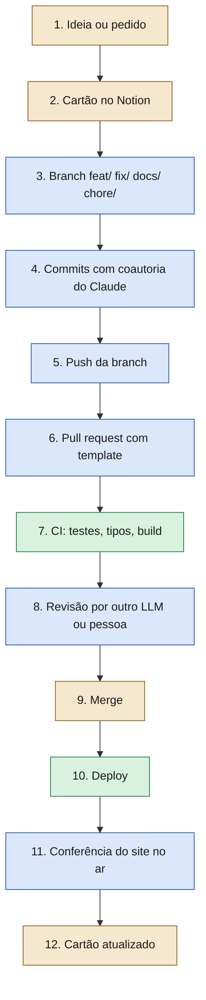

# Diagnóstico da Fase 1 · Workshop de IA (SONORA)

Levantamento feito em **19/10/2026**, na véspera do workshop de **20/10/2026**.
Ele responde a uma pergunta: *o que existe, o que funciona e o que ainda precisa ser
conferido* antes de construir o site ao vivo com o Claude Code.

Este arquivo é a versão em linguagem clara. Os relatórios brutos, com a evidência de cada
fato, ficam na pasta de trabalho do instrutor (fora deste repositório).

## Como ler os marcadores

| Marcador | Significa |
|---|---|
| **[verificado]** | Conferido com ferramenta (um comando, uma consulta) ou na documentação oficial, com fonte. |
| **[inferido]** | Dedução razoável a partir de evidência, mas sem confirmação direta. |
| **[não confirmado]** | Não deu para conferir. Tratar como **conferir antes da aula**. |

> **Analogia.** É como a ficha de um paciente: "exame feito" (verificado), "suspeita pelo
> sintoma" (inferido) e "exame pendente" (não confirmado). Só o primeiro vai para o laudo
> sem ressalva.

## Resumo em seis linhas

1. A demo roda no **app Claude Desktop (aba Code)**: o comando `claude` não está no PATH do PC do instrutor. [verificado]
2. Modelos atuais: **Fable 5.1, Opus 5.5, Sonnet 5.5 e Haiku 5.5**. Os preços da API estão confirmados; os das assinaturas, não. [verificado] / [não confirmado]
3. Os modos de permissão hoje se chamam **Manual, Accept edits, Plan e Auto**. "Ask permissions" é o nome antigo. [verificado]
4. **Effort não é temperatura.** Effort regula quanto o modelo pensa; a temperatura não é ajustável no Claude Code. [verificado] / [inferido]
5. O fluxo profissional do WRW vira um modelo enxuto no SONORA: cartão, branch, PR, CI, revisão, merge manual e deploy automático.
6. Mídia **pré-gerada** na Higgsfield (custa créditos) e site estático **grátis** no GitHub Pages. [verificado]

Sumário:

1. [Ambiente do instrutor](#1-ambiente-do-instrutor)
2. [Claude e Claude Code](#2-claude-e-claude-code)
3. [Fluxo profissional do WRW](#3-fluxo-profissional-do-wrw)
4. [Skills e conectores](#4-skills-e-conectores)
5. [Referências visuais e técnicas de scroll](#5-referências-visuais-e-técnicas-de-scroll)
6. [Mídia, deploy e custos](#6-mídia-deploy-e-custos)
7. [Limitações](#7-limitações)

---

## 1. Ambiente do instrutor

### 1.1 Ferramentas e versões

| Ferramenta | Situação em 19/10/2026 | Status |
|---|---|---|
| Claude Code | Embutido no app Claude Desktop, versões **2.1.299** e 2.1.295. O binário responde `2.1.299 (Claude Code)`. | [verificado] |
| Comando `claude` no terminal | **Não está no PATH** do PowerShell nem do Git Bash. Demo no app desktop. | [verificado] |
| Node.js / npx | Node **v24.15.0**, npx 11.12.1. Atende Vite e Playwright. | [verificado] |
| Git e GitHub CLI (`gh`) | `gh` logado com os escopos `repo` e `workflow`. Sem `read:user`, então o plano da conta não pôde ser lido. | [verificado] |
| Conta GitHub Movits | Conta de usuário (não organização), com repositórios públicos. | [verificado] |
| Google Chrome | Instalado. É o navegador que os testes do Playwright usam. | [verificado] |
| ffmpeg | Build 8.1.2 full, instalado pelo WinGet. A versão foi lida do nome da pasta; `ffmpeg -version` não foi rodado. | [inferido] |
| Higgsfield CLI | Versão 1.1.13, logada, plano Plus, **1.000 créditos** no momento do diagnóstico. | [verificado] |
| Python | 3.14.5, com Pillow, lxml, pypdf e PyMuPDF. | [verificado] |
| Disco | 269,5 GB livres. | [verificado] |

### 1.2 O que faltava no momento do diagnóstico

| Faltava | Impacto | Status |
|---|---|---|
| `claude` no PATH | Demo no terminal falharia. Decisão: demo no app desktop. | [verificado] |
| python-pptx, markitdown, defusedxml, pdfplumber, reportlab, pptxgenjs | Gerar e conferir o deck em .pptx localmente não funcionaria. | [verificado] |
| LibreOffice (`soffice`) e Poppler (`pdftoppm`) | A conferência visual do deck (renderizar slides em imagens) não funcionaria. | [verificado] |
| CLIs da Vercel, Netlify e Cloudflare (wrangler) | Nenhum impacto: o deploy é no GitHub Pages. Se precisar, dá para rodar por `npx`. | [verificado] |
| Conector editor do Google Slides | Não havia **naquela sessão**. Isso não prova que a conta não tenha. | [verificado] para a sessão |

### 1.3 Conectores e servidores MCP vistos

- Conectores da sessão: Google Drive, Notion, Higgsfield, Gmail, Calendar, Chrome e controle do computador. [verificado]
- Servidores MCP locais: **Playwright** (via `npx`, depende de rede) e **Figma** (pede autenticação). [verificado]

### 1.4 Configuração do palco (o que ajustar)

A configuração pessoal do instrutor usa o modelo Fable com contexto de 1M, effort **xhigh** e
modo **Auto**. Também tem hooks pessoais que imprimem avisos na tela, além de controle
remoto e envio de sessões ligados. [verificado]

Para iniciantes, isso é **lento, caro e executa sem perguntar**: a lição errada.
Recomendação do diagnóstico:

- Na demo, usar **Sonnet 5.5**, effort **medium** e modo **Manual** ou **Accept edits**.
- Demonstrar só numa pasta limpa do SONORA, sem `.env` nem credenciais por perto.
- Decidir antes da aula se os hooks pessoais ficam ligados.

---

## 2. Claude e Claude Code

Fontes: documentação oficial em `platform.claude.com/docs` e `code.claude.com/docs`, lida em
19/10/2026. Os comandos foram conferidos **na documentação**, não um a um na versão instalada:
conferir na sua versão.

### 2.1 Modelos e preços da API

Preço em **US$ por milhão de tokens** (MTok). Token é um pedaço de palavra; 1 milhão de
tokens é muito texto (vários livros).

| Modelo | Alias no Claude Code | Entrada / saída | Effort padrão no Claude Code | Indicado para | Status |
|---|---|---|---|---|---|
| **Fable 5.1** | `fable` | 10 / 50 | high | raciocínio difícil, trabalho agêntico longo | [verificado] |
| **Opus 5.5** | `opus` (é o `default` em Pro, Max, Team e Enterprise) | 4 / 20 | medium | código agêntico longo, trabalho de conhecimento | [verificado] |
| **Sonnet 5.5** | `sonnet` | 2 / 10 | medium | equilíbrio entre velocidade e inteligência | [verificado] |
| **Haiku 5.5** | `haiku` | 0,10 / 0,50 (prompt até 100 mil tokens); 0,50 / 2,50 acima | medium | volume alto, classificação, extração | [verificado] |

- Os quatro têm janela de contexto de **1M de tokens** e saída de até 128 mil tokens. [verificado]
- Batch da API custa 50% menos; leitura de cache é bem mais barata que entrada normal. [verificado]
- Outros aliases: `best`, `opusplan` (Opus no plano, Sonnet na execução), `sonnet[1m]`, `opus[1m]`. [verificado]
- O instrutor tem acesso ao Fable. [inferido] Se os alunos terão, não se sabe. [não confirmado]

**Assinatura x API.** Pela API, paga-se por token. As assinaturas (Pro, Max, Team,
Enterprise) incluem uso dentro de limites por sessão e por semana. [verificado]
Os **preços mensais e as cotas** das assinaturas **não foram confirmados**: não citar valores
sem conferir em claude.com/pricing. [não confirmado]

> Sessão longa gasta mais: cada pedido reenvia a conversa (com cache mais barato). Usar
> `/clear` entre tarefas diferentes não custa nada. [verificado]

### 2.2 Effort (quanto o modelo pensa)

> **Analogia.** Effort é quanto tempo o aluno pensa antes de responder a prova. Temperatura
> seria quão "solto" ele sorteia as palavras. São coisas diferentes.

- Níveis: **low, medium, high, xhigh, max**. `auto` não é um nível: limpa o nível salvo. [verificado]
- Como mudar: `/effort <nível>`; `/effort` sem argumento abre um controle deslizante;
  `/effort status` mostra o nível atual; `claude --effort <nível>` no terminal. [verificado]
- `max` vale só para a sessão atual. [verificado]
- No app desktop há um seletor de effort na interface. O atalho documentado é Cmd+Shift+E no
  Mac (Ctrl+Shift+E no Windows). [verificado na documentação; conferir na sua versão]
- **Divergência:** a doc do Claude Code diz que o padrão do Sonnet 5.5 é medium; a doc da
  API diz high. Por isso, na demo, **fixe o effort** com `/effort medium`. [verificado]
- **Temperatura:** nos modelos atuais, a API devolve erro 400 para temperatura fora do
  padrão. [verificado] O Claude Code não documenta nenhum controle de temperatura. [inferido]

### 2.3 Modos de permissão

Modo de permissão é o "quanto o Claude pode fazer sem perguntar".

| Nome na interface | Valor na configuração | Roda sem perguntar | Uso na aula | Status |
|---|---|---|---|---|
| **Manual** | `default` | só leitura | Notion, GitHub, depuração | [verificado] |
| **Accept edits** | `acceptEdits` | leitura, edição de arquivos, criar e mover pastas | construir e animar o site | [verificado] |
| **Plan** | `plan` | só leitura; edita depois que você aprova o plano | planejar antes de mexer | [verificado] |
| **Auto** | `auto` | tudo, com um classificador revisando | não usar com iniciantes | [verificado] |
| Don't ask | `dontAsk` | só o que foi pré-aprovado; fica fora do ciclo; CLI | não usado | [verificado] |
| Bypass permissions | `bypassPermissions` | tudo; feito para contêiner ou VM | **não será usado** | [verificado] |

- "Ask permissions" é o nome antigo. A interface atual diz **Manual**. [verificado]
- No terminal, **Shift+Tab** troca de modo: Manual → Accept edits → Plan → (Bypass, se ativado) → Auto → Manual. [verificado]
- No app desktop, o seletor de modo fica abaixo da caixa do prompt; o Plan vale só para a sessão. [verificado]
- O Auto é o modo inicial no terminal e no VS Code desde a versão 2.1.283. A própria doc diz
  que o classificador **não garante segurança**. [verificado]

### 2.4 Comandos

Todos conferidos na documentação em 19/10/2026 [verificado na documentação; conferir na sua versão].

| Comando | O que faz | Observação |
|---|---|---|
| `/help` | Ajuda e lista de comandos. | |
| `/init` | Cria o `CLAUDE.md` do projeto. | |
| `/model` | Troca o modelo. | No desktop, também há seletor na interface. |
| `/effort` | Ajusta o effort. | `/effort status` mostra o atual. |
| `/plan` | Entra no modo Plan. | `/plan <tarefa>` já começa planejando. |
| `/skills` | Lista as skills disponíveis. | |
| `/mcp` | Status dos conectores e servidores MCP. | |
| `/diff` | Mostra as mudanças nos arquivos. | |
| `/context` | Mostra quanto do contexto está ocupado. | |
| `/compact [instruções]` | Resume a conversa para liberar contexto. | Aceita instruções do que manter. |
| `/clear` | Começa uma conversa nova. | Aliases `/reset` e `/new`. |
| `/usage` | Uso da sessão e limites do plano. | `/cost` e `/stats` são aliases. |
| `/permissions` | Regras de permissão (allow, ask, deny). | No desktop, sem argumento, não funciona. |
| `/memory` | Edita o `CLAUDE.md` e liga ou desliga a memória automática. | |
| `/resume` | Retoma uma sessão anterior. | |
| `/rewind` | Volta a um checkpoint. | No desktop: [não confirmado]. |
| `/config` | Abre as configurações. | No desktop, ignora argumentos. |
| `/status` | Abre a aba Status das configurações. | |
| `/doctor` | Checkup da instalação. | Virou **skill empacotada** (alias `/checkup`). |
| `/agents` | Hoje só mostra um lembrete. | Subagentes se criam **pedindo ao Claude** ou em `.claude/agents/`. |
| `/review` | Revisão de código. | É alias de `/code-review` (skill); `--fix` aplica os achados. |

- No app desktop funcionam, segundo a doc: `/code-review`, `/btw`, `/compact` e `/remote-control`. [verificado]
- Alguns comandos abrem painel interativo só no terminal. No desktop, use os seletores da
  interface para modelo, modo e effort. [verificado]

### 2.5 Contexto e checkpoints

- **Auto-compact:** perto do limite, o Claude Code limpa saídas antigas de ferramentas e
  depois resume a conversa. Nos modelos de 1M, isso acontece por volta de 967 mil tokens. [verificado]
- Depois de compactar, o `CLAUDE.md` da raiz volta do disco. Instruções que precisam durar
  vão no `CLAUDE.md`, não só na conversa. [verificado]
- **Checkpoints** são criados antes de cada prompt. O `/rewind` (ou Esc duas vezes) restaura
  código, conversa ou os dois. **Não** desfazem comandos de terminal nem edições feitas fora
  do Claude, e **não substituem o git**. [verificado]

### 2.6 Qual combinação usar (sugestão)

A documentação não traz receita pronta; esta tabela junta as recomendações oficiais de cada
modelo e de cada modo. [inferido]

| Tarefa | Modelo | Effort | Modo |
|---|---|---|---|
| Pesquisar, entender o código | Sonnet 5.5 | medium | Plan ou Manual |
| Planejar uma feature | Opus 5.5 | high | Plan |
| Construir e animar o site | Sonnet 5.5 | medium | Accept edits |
| Depurar um erro | Opus 5.5 | high | Manual |
| Revisar uma PR | Opus 5.5 | high | Plan ou Manual (`/code-review` sem `--fix`) |
| GitHub e Notion | Sonnet 5.5 | medium | Manual (ação externa pede confirmação) |
| Documentação em lote | Haiku 5.5 | low | Accept edits |

---

## 3. Fluxo profissional do WRW

Esta seção mostra **só o processo** de trabalho de um projeto real com IA, para servir de
modelo. Não traz números da prática, nomes, cliente nem dados internos.

> **Analogia.** É uma linha de montagem com três tipos de estação: onde uma pessoa decide
> (manual), onde a IA faz e a pessoa confere (assistido) e onde a máquina faz sozinha toda
> vez (automatizado).

### 3.1 Diagrama das etapas



Versão em texto (para slide ou para onde o diagrama não aparece):

```text
[M] Ideia → [M] Cartão → [A] Branch → [A] Commits → [A] Push → [A] PR
→ [Auto] CI → [A] Revisão → [M] Merge → [Auto] Deploy → [A] Conferência → [M] Cartão atualizado

[M] manual (uma pessoa decide)   [A] assistido por IA (o Claude faz, a pessoa confere)   [Auto] automatizado
```

### 3.2 O que acontece em cada etapa

| # | Etapa | Tipo | O que acontece | Guarda-corpo |
|---|---|---|---|---|
| 1 | Ideia ou pedido | Manual | Alguém pede uma mudança. | O pedido é anotado, não fica só na conversa. |
| 2 | Cartão no Notion | Manual (o Claude lê e ajuda a escrever) | O pedido vira cartão com responsável, prazo e o que é "pronto". | Sem cartão, não começa. |
| 3 | Branch | Assistido | Uma branch nova a partir da `main` atualizada: `feat/`, `fix/`, `docs/` ou `chore/`. | Uma skill de projeto confere o quadro e o repositório antes de começar; um hook bloqueia o Claude sem essa conferência. |
| 4 | Commits | Assistido | Mensagens no padrão **Conventional Commits**, em português, com a linha `Co-Authored-By` do Claude. O corpo diz como verificar. | Histórico legível: dá para saber o que mudou e quem ajudou. |
| 5 | Push | Assistido | O Claude envia a **própria branch** (`git push -u origin <branch>`). | Push direto na `main` e `--force` são negados nas permissões do projeto. |
| 6 | Pull request | Assistido | Uma skill de projeto roda as mesmas checagens do CI, faz um `/code-review` e preenche o template: **O que muda / Por quê / Como verifiquei / Como validar / Riscos**. | A PR explica a mudança para quem não estava lá. |
| 7 | CI | Automatizado | O GitHub Actions roda em toda PR e todo push na `main`: testes, checagem de tipos e build. | Check **obrigatório** para mesclar. |
| 8 | Revisão | Assistido | Outro LLM (o Claude de outra pessoa ou outro modelo) ou uma pessoa revisa. Mudança visual pede olho humano. | Quem escreveu não é quem revisa. |
| 9 | Merge | Manual | Uma pessoa decide mesclar. O Claude só mescla quando pedem. | Merge pede confirmação nas permissões do projeto. |
| 10 | Deploy | Automatizado | O merge na `main` publica sozinho. | Ninguém sobe arquivo "na mão". |
| 11 | Conferência no ar | Assistido, disparado à mão | Um script confere o site publicado e o resultado fica registrado na PR. | Prova de que funcionou em produção, não só no computador. |
| 12 | Cartão atualizado | Manual ou assistido | Cartão vai para "Feito (a validar)" com o link da PR; **outra pessoa** valida e conclui. | Regra "quem faz não conclui". |

Status das etapas:

- O processo acima está **documentado** no repositório do projeto e nas skills de projeto. [verificado]
- Deploy automático do **site estático** pelo GitHub Pages. [verificado] Deploy automático do
  **servidor** a cada merge: documentado no repositório, mas o painel do provedor não foi
  conferido. [inferido]
- Os guarda-corpos (permissões e hook) só valem dentro do Claude Code. O botão de merge do
  site do GitHub e um terminal comum passam ao largo: **é disciplina, não segurança
  absoluta**. [verificado]

### 3.3 Como o SONORA reproduz o fluxo (versão enxuta)

| Etapa no WRW | No SONORA |
|---|---|
| Cartão no Notion | Quadro **Trabalho \| SONORA** (ver `workshop/notion-template.md`). |
| Branch | `feat/...` criada pelo Claude a partir da `main`. |
| Commits | Conventional Commits em português, com coautoria do Claude. |
| PR com template | Mesmas seções: O que muda / Por quê / Como verifiquei / Como validar / Riscos. |
| CI | GitHub Actions com testes do Playwright e build do Vite. |
| Revisão | `/code-review` do Claude como "outro LLM revisa", mais o olhar de uma pessoa. |
| Merge | Manual, feito por uma pessoa. |
| Deploy | GitHub Pages via Actions: `https://movits.github.io/sonora/`. |
| Cartão atualizado | Comprovação com a URL da PR → "Feito (a validar)" → outra pessoa valida → "Concluído". |

---

## 4. Skills e conectores

### 4.1 O que é uma skill

> **Analogia.** Skill é uma receita guardada na gaveta. O Claude só abre a gaveta quando o
> pedido combina com o rótulo (a descrição) ou quando você chama pelo nome.

- Uma skill é uma **pasta com um arquivo `SKILL.md`**. [verificado]
- O topo do arquivo (frontmatter) tem `name` e `description`. A descrição é o que o Claude lê
  para decidir quando usar. [verificado]
- Onde ficam: `~/.claude/skills/<nome>/` (pessoais, valem em todos os projetos) ou
  `.claude/skills/<nome>/` (do projeto, vão junto com o repositório). [verificado]
- Como usar: digitando `/nome` ou automaticamente, quando o pedido combina com a descrição. [verificado]
- Limites: a descrição é cortada em 1.536 caracteres; o `SKILL.md` deve ficar com até 500
  linhas. O validador do skill-creator pede `name` em kebab-case (até 64 caracteres) e
  `description` de até 1.024 caracteres. [verificado]

Exemplo mínimo:

```markdown
---
name: review-landing
description: Revisa a landing page do projeto (layout, movimento, acessibilidade) e devolve uma tabela Antes / Depois / Por quê. Use quando pedirem para revisar a landing.
---

# Revisar a landing

1. Rode `npm test` e `npm run build`.
2. ...
```

Outras peças do Claude Code, para não confundir [verificado]:

| Peça | O que é |
|---|---|
| `CLAUDE.md` | Instruções permanentes do projeto (o "manual da casa"). |
| Skill | Receita que o modelo segue quando o pedido combina. |
| Subagente | Um "ajudante" com contexto próprio, em `.claude/agents/`. |
| Hook | Script que roda num evento, **sem** depender de o modelo decidir. |
| MCP / conector | Ponte para um serviço externo (Notion, Drive, Figma...). |
| Plugin | Pacote que junta skills, hooks, subagentes e MCP. |

### 4.2 O que existe no ambiente do instrutor

| Skill | O que faz | Observação | Status |
|---|---|---|---|
| taste-skill | Direção de arte para sites; inspetor que abre a página no Chrome a 1440, 768 e 390 px e reprova problemas. | A biblioteca de cenas prontas não veio instalada; só a base. | [verificado] |
| gpt-tasteskill | Padrão GSAP + ScrollTrigger com cinco efeitos de rolagem. | **Conflita** com a taste-skill (pede o que a outra proíbe). | [verificado] |
| skill-creator | Ajuda a criar e validar skills. | | [verificado] |
| emil-design-eng, animate | Guias de movimento e acabamento de interface. | Sem dependências. | [verificado] |
| verification-before-completion | Regra "evidência antes de afirmar". | | [verificado] |
| frontend-design | Guia leve de direção visual. | | [verificado] |
| pptx | Gera deck com pptxgenjs e notas com `slide.addNotes()`. | Faltavam ferramentas no PC (seção 1.2). | [verificado] |
| higgsfield-generate, higgsfield-product-photoshoot | Geram imagem e vídeo. | **Gastam créditos.** | [verificado] |

### 4.3 Conectores usados na aula

| Serviço | Como o Claude acessa | Observação |
|---|---|---|
| GitHub | `gh` CLI (já logado) | Mais simples que um MCP e mostra comandos reais aos alunos. |
| Notion | Conector (MCP) | **Ler** é livre; **escrever** só com autorização (ver `workshop/notion-template.md`). |
| Higgsfield | CLI e conector | Assets do SONORA **pré-gerados**: custo, fila e rede tornam a geração ao vivo arriscada. |
| Google Drive | Conector | Material de apoio. |
| Playwright | Pacote `@playwright/test` no projeto, usando o Chrome instalado | Testes rodam no projeto e no CI, sem depender de MCP. |

### 4.4 O que foi escolhido e por quê

- **Uma skill de projeto pequena e real:** `.claude/skills/review-landing/` no repositório
  SONORA. Os alunos veem uma skill versionada junto com o código.
- **Uma só skill de design como principal.** Usar a taste-skill e a gpt-tasteskill juntas
  gera regras contraditórias e mensagens confusas para iniciantes. [verificado: o conflito]
- **Skills de terceiros só depois de ler o `SKILL.md`** (ver o estudo de caso em 4.6).

### 4.5 Skills recomendadas aos alunos

Origem e licença verificadas em 19/10/2026. Para instalar: copie a pasta da skill para
`.claude/skills/<nome>/` (projeto) ou `~/.claude/skills/<nome>/` (pessoal), **depois** de ler
o `SKILL.md`. Alguns repositórios também oferecem instalação como plugin: siga o README de
cada um (conferir na sua versão).

| Repositório | Skills | Licença | Observação | Status |
|---|---|---|---|---|
| [anthropics/skills](https://github.com/anthropics/skills) | frontend-design, webapp-testing, skill-creator | Apache 2.0 | As de docx, pdf, pptx e xlsx têm código visível, mas licença proprietária. | [verificado] |
| [vercel-labs/agent-skills](https://github.com/vercel-labs/agent-skills) | web-design-guidelines, react-best-practices | MIT | A web-design-guidelines baixa as regras da internet quando roda. A react-best-practices só ajuda se o projeto usar React. | [verificado] |
| [greensock/gsap-skills](https://github.com/greensock/gsap-skills) | 8 skills: core, timeline, scrolltrigger, plugins, react, frameworks, performance, utils | MIT | Oficial da GSAP; casa com a stack do SONORA. | [verificado] |

Também levantadas, sem prioridade para a aula: obra/superpowers (MIT; TDD, depuração, code
review; telemetria opcional que dá para desligar) e addyosmani/web-quality-skills (MIT;
acessibilidade, performance, Core Web Vitals). [verificado]

### 4.6 Estudo de caso de segurança: scroll-craft

O **scroll-craft**, do Nate Herk, é a skill apresentada no vídeo "I Built The Ultimate Claude
Website Design Skill (steal this)". Ela faz uma entrevista, gera os assets, monta o site com
scroll e confere o resultado num navegador automático. [verificado]

- Repositório: [nateherkai/scroll-craft](https://github.com/nateherkai/scroll-craft), público, licença **MIT**, versão 0.3.1 (último commit em 30/09/2026). [verificado]
- Instala como plugin `nateherk-design` e roda com `/nateherk-design:scroll-craft`. [verificado]
- O `SKILL.md` libera as ferramentas Bash, Read, Write, Edit, Glob, Grep e AskUserQuestion. Roda scripts próprios, ffmpeg e Playwright. [verificado]

**Sinais de risco encontrados:**

| Sinal | Por que importa | Status |
|---|---|---|
| O script de geração procura um `.env` **subindo até 8 pastas** acima da atual. | Pode pegar a chave de API de **outro projeto** seu sem você perceber. | [verificado] |
| O servidor local (`serve.mjs`) **serve dotfiles** (issue aberta). | Um `.env` na pasta do site fica legível pelo navegador. | [verificado] |
| A opção `--lan` expõe o servidor na rede (0.0.0.0). | Qualquer pessoa no mesmo Wi-Fi acessa, inclusive o `.env` acima. | [verificado] |
| Envia imagens locais em base64 para um domínio de terceiros (kieai.redpandaai.co) e chama api.kie.ai. | Suas imagens saem do computador; a geração custa créditos pagos. | [verificado] |
| Um artigo de terceiros diz que ela usa fal.ai; o código usa kie.ai. | Confie no código, não no artigo. | [verificado] |
| Não foram achados `curl \| bash`, binários nem telemetria. | Bom sinal, mas a varredura foi por busca de texto, não auditoria completa. | [verificado] |

**Lição: checklist antes de instalar qualquer skill.**

1. Quem publicou? Qual é a licença?
2. Leia o `SKILL.md`: quais ferramentas ele libera (Bash é o mais poderoso)?
3. Procure nos scripts: acesso à rede, leitura de `.env` ou credenciais, servidores.
4. Veja as issues abertas do repositório.
5. Rode primeiro numa pasta de teste, **sem segredos** por perto.
6. Nunca deixe chaves de API dentro de uma pasta que algum servidor vai servir.

Na aula, o scroll-craft é **mostrado** (o `SKILL.md` e os riscos), não instalado nem rodado.

---

## 5. Referências visuais e técnicas de scroll

### 5.1 Técnicas comparadas

| Técnica | O que é | A favor | Contra | Status |
|---|---|---|---|---|
| **GSAP + ScrollTrigger** (3.15) | Biblioteca JavaScript que liga animações à rolagem. | Confiável, bem documentada, a mais fácil de ensinar. Grátis com todos os plugins, inclusive para uso comercial. | Licença própria da Webflow, não é open source OSI. | [verificado] |
| **CSS `animation-timeline`** | Animação ligada à rolagem só com CSS. | Peso zero; ótima para detalhes. | Chrome e Edge 115+, Safari 26+. Firefox só a partir da 159 (lançamento previsto para 27/10/2026). Use `@supports`. | [verificado] |
| **Sequência de imagens em canvas** | Cada posição da rolagem mostra um quadro de uma sequência. | A mais previsível: o mesmo quadro sempre na mesma posição. | Pesa (90 a 150 quadros WebP de ~1600 px dão de 5 a 15 MB) e usa memória. | [inferido] |
| **Vídeo atrelado ao scroll** | A rolagem avança o tempo de um vídeo. | Arquivo único. | Precisa de quadros-chave densos (`-g 1` a `-g 8`); instável no celular. | [inferido] (fontes secundárias) |
| **Three.js / R3F com GLB** | Modelo 3D real no navegador. | O mais impressionante. | Depende da GPU; GLB gerado por IA vem numa peça só; o carregador padrão do drei baixa um decodificador da internet (quebra offline). | [verificado] / [inferido] |
| **Lenis** | Rolagem suave. | Licença MIT, opcional. | Pode ficar estranho com trackpad e passador de slides. | [inferido] |

### 5.2 O que o SONORA usa

- **Vite + JavaScript puro** (sem React) e **GSAP 3.15 com ScrollTrigger instalados pelo npm**:
  nada vem de CDN, então o site funciona sem depender de rede externa. Fontes locais
  (Unbounded e Onest, pelos pacotes `@fontsource` do npm, empacotadas no build).
- **Exploded view:** canvas fixado (pinned) com cerca de **120 quadros WebP**, extraídos com
  ffmpeg de um vídeo gerado na Higgsfield (fone montado → explodido), avançados pelo scrub
  do ScrollTrigger.
- **Seção Engenharia:** blueprint em SVG animado por código.
- **`prefers-reduced-motion`:** quem pede menos movimento vê uma composição estática.
- **Testes** com Playwright usando o Chrome instalado; **CI** no GitHub Actions.

> O diagnóstico sugeriu HTML puro com GSAP copiado para uma pasta local. A decisão final
> (Vite + npm) segue o mesmo princípio: nada de CDN e site que funciona offline depois do build.

### 5.3 Referências com link

Os endereços marcados como [verificado] responderam em 19/10/2026. Nos marcados como
[inferido], a página foi citada (e em vários casos respondeu) no levantamento, mas o endereço
exato não ficou registrado e foi montado aqui a partir do nome: **conferir antes da aula**.

**Produto e fones**

| Referência | Link | O que observar | Status |
|---|---|---|---|
| Apple AirPods Pro | https://www.apple.com/airpods-pro/ | Capítulos animados por rolagem com vídeo inline. Se ainda usa canvas: [não confirmado]. | [verificado] |
| Apple AirPods Max | https://www.apple.com/airpods-max/ | Produto premium apresentado por rolagem. | [verificado] |
| Sonos Ace | https://www.sonos.com/ (procure "Sonos Ace") | Página de fone premium. | [verificado] a página respondeu; endereço exato: [inferido] |
| Bang & Olufsen Beoplay H100 | https://www.bang-olufsen.com/ (procure "Beoplay H100") | Fotografia de produto e materiais. | [verificado] a página respondeu; endereço exato: [inferido] |
| Nothing Headphone (1) | https://nothing.tech/ (procure "Headphone (1)") | Identidade forte e técnica. | [verificado] a página respondeu; endereço exato: [inferido] |
| Sony WH-1000XM6 | — | Se tem exploded view na rolagem: [não confirmado] (páginas bloquearam o acesso automático). | [não confirmado] |

**Narrativa com scroll e vitrines**

| Referência | Link | O que observar | Status |
|---|---|---|---|
| igloo.inc | https://www.igloo.inc/ · [ficha no Awwwards](https://www.awwwards.com/sites/igloo-inc) | Site do Dia no Awwwards em 23/07/2024. | [verificado] |
| GSAP Showcase | https://gsap.com/showcase/ | Exemplos reais feitos com GSAP. | [verificado] |
| Coleções de scrolling e storytelling do Awwwards | https://www.awwwards.com/ (procure as coleções "scrolling" e "storytelling") | Galeria para buscar ideias por tema. | [verificado] as coleções responderam; endereço exato: [inferido] |
| NYT Snow Fall | https://www.nytimes.com/projects/2012/snow-fall/ | Clássico do scrollytelling jornalístico. | [inferido] |
| SBS The Boat | https://www.sbs.com.au/theboat/ | Quadrinho narrado pela rolagem. | [inferido] |
| The Pudding | https://pudding.cool/ | Ensaios visuais com dados e rolagem. | [verificado] |
| Turismo: Tourisme Sumène Artense | procurar pelo nome no Awwwards | Exemplo para o tema "agência de viagens". | [inferido] |
| Gastronomia: Haven Coffee + Kitchen | procurar pelo nome no Awwwards | Exemplo para "cafeteria" ou "hamburgueria". | [inferido] |

**Técnica e documentação**

| Referência | Link | Status |
|---|---|---|
| Documentação do ScrollTrigger | https://gsap.com/docs/v3/Plugins/ScrollTrigger/ | [verificado] |
| Licença padrão da GSAP | https://gsap.com/standard-license/ | [verificado] |
| Tutorial da CSS-Tricks que recria o canvas dos AirPods | https://css-tricks.com/lets-make-one-of-those-fancy-scrolling-animations-used-on-apple-product-pages/ | [inferido] |
| Demonstrações de scroll-driven animations em CSS | https://scroll-driven-animations.style/ | [verificado] |
| `animation-timeline` no MDN | https://developer.mozilla.org/en-US/docs/Web/CSS/animation-timeline | [inferido] |

---

## 6. Mídia, deploy e custos

### 6.1 Higgsfield (imagem e vídeo)

- Conta no plano **Plus**, com **1.000 créditos** no momento do diagnóstico. [verificado, consulta de saldo em 19/10/2026]
- As consultas de preço (`get_cost`) não gastaram créditos. [verificado]

**Preço em créditos** (consulta de custo na conta, 19/10/2026):

| Item | Créditos | Status |
|---|---|---|
| Imagem: GPT Image 2.5, de 2K medium a 4K high | 1 a 4,25 | [verificado] |
| Imagem: Nano Banana Pro, 2K / 4K | 2 / 4 | [verificado] |
| Vídeo 10 s: Kling 3.0 pro | 17,5 | [verificado no briefing do workshop; não fez parte da consulta de custo acima] |
| Vídeo 10 s: Seedance 2.5, 720p / 1080p | 70 / 160 | [verificado no briefing do workshop; a consulta acima deu 80 para 5 s em 1080p, o que bate com 160 para 10 s] |
| Vídeo 5 s sem áudio: Kling 3.0 std | 7,5 | [verificado] |
| Vídeo 5 s sem áudio: Seedance 2.0, 720p fast / 720p std / 1080p std | 12,5 / 22,5 / 60 | [verificado] |
| Modelo 3D (GLB): Tripo multiview / Meshy 7 imagem→3D | 9 / 38 | [verificado] |

**Crédito em dinheiro:** de cerca de **US$0,033** (plano Ultra anual: US$99/mês por 3.000
créditos) a **US$0,059** (pacote avulso de 500 créditos por US$29,41). Créditos avulsos
vencem em 90 dias. [verificado, tela de planos da Higgsfield, 19/10/2026]
O preço mensal do plano Plus: [não confirmado] (fontes de terceiros divergem).

Conta de bolso (multiplicação feita aqui) [inferido]:

| Item | Créditos | Em dólar (US$0,033 a US$0,059 por crédito) |
|---|---|---|
| 1 imagem | 1 a 4,25 | ~US$0,03 a US$0,25 |
| 1 vídeo de 10 s, Kling 3.0 pro | 17,5 | ~US$0,58 a US$1,03 |
| 1 vídeo de 10 s, Seedance 2.5 720p | 70 | ~US$2,31 a US$4,13 |
| 1 vídeo de 10 s, Seedance 2.5 1080p | 160 | ~US$5,28 a US$9,44 |

Outros pontos:

- **Mesmo produto em todas as imagens:** Elements (referência fixa no prompt), imagem→imagem a
  partir do hero aprovado, e quadro inicial e final no vídeo. [verificado]
- **Tempo de geração:** de 30 a 90 s por clipe curto, com fila variável. [inferido, fontes de terceiros]
  Por isso os assets foram **pré-gerados**.
- **3D gerado por IA** sai numa malha única, sem peças separadas: não serve para exploded view. [inferido]
- **Direitos:** a central de ajuda diz que o resultado é do usuário e pode ter uso comercial. [verificado na central de ajuda, não nos termos]
- **Privacidade:** por padrão, a Higgsfield pode usar o conteúdo para treinar modelos. Não
  envie fotos pessoais. [verificado]

### 6.2 Deploy (publicar o site)

| Serviço | Grátis? | Limites e regras | Status |
|---|---|---|---|
| **GitHub Pages** (escolhido) | Sim, com repositório **público** | Site até 1 GB; 100 GB/mês de banda (limite flexível); 10 builds por hora; não pode ser hospedagem de negócio online. Repositório privado exige GitHub Pro. | [verificado] |
| Vercel Hobby | Sim | Só uso pessoal, **não comercial**; 100 GB/mês. Pro a US$20/mês. | [verificado] |
| Netlify Free | Sim | 300 créditos/mês; cada GB de banda custa 20 créditos. Personal a US$9; Pro a US$20. | [verificado] |
| Cloudflare Pages | Sim | 500 builds/mês; **até 25 MiB por arquivo**; 20 mil arquivos. Banda ilimitada: [não confirmado]. | [verificado] |

- Preço do GitHub Pro (cerca de US$4/mês): [inferido, fonte de terceiros].
- O SONORA está em repositório público, com deploy pelo GitHub Actions:
  https://movits.github.io/sonora/

### 6.3 Domínio próprio (opcional)

| Domínio | Preço | Fonte | Status |
|---|---|---|---|
| `.com.br` | R$40/ano, no Registro.br | Matéria de imprensa de 14/10/2026 citando o NIC.br | [verificado] (fonte de imprensa) |
| `.com` | cerca de US$10/ano | A Cloudflare vende a preço de custo [verificado]; o valor exato vem de um agregador [inferido] | [inferido] |

### 6.4 Se o projeto precisar de banco de dados (fora do escopo da aula)

| Serviço | Plano grátis | Status |
|---|---|---|
| Supabase Free | 500 MB de banco, 1 GB de arquivos, 5 GB de tráfego, 50 mil usuários ativos/mês, 2 projetos. Pausa após 1 semana sem uso. Pro a partir de US$25/mês. | [verificado] |
| Firebase Spark | Hosting com 10 GB; Firestore com 1 GiB, 50 mil leituras e 20 mil gravações por dia; Auth com 50 mil usuários ativos/mês. | [verificado] |

### 6.5 Resumo de custo do SONORA

| Parte | Custo |
|---|---|
| Hospedagem (GitHub Pages, repo público) | US$0 [verificado] |
| Mídia (Higgsfield) | Créditos; ver tabela 6.1 [verificado] |
| Claude pela API | Por token; ver tabela 2.1 [verificado] |
| Claude por assinatura | Valores **não confirmados**: conferir antes da aula [não confirmado] |
| Domínio | Opcional; o subdomínio `github.io` é grátis [verificado] |

---

## 7. Limitações

O que este diagnóstico **não** conseguiu confirmar, e o que fazer com isso:

| Limitação | Consequência | O que fazer |
|---|---|---|
| **Vídeo do Nate Herk sem transcrição.** O YouTube e os sites de transcrição bloquearam o acesso. Só foram lidos o título, a descrição e os capítulos. | Não sabemos o que exatamente foi mostrado na demonstração. | Não afirmar nos slides nada além da descrição. Os links da descrição levam a captação de contatos e afiliados: não divulgar como "o download". [não confirmado] |
| **Preços das assinaturas** Pro, Max e Team (e as cotas) não foram lidos: a página de preços não pôde ser acessada. | Valor errado no slide. | Conferir em claude.com/pricing antes da aula ou usar só os preços da API. [não confirmado] |
| **Notas do apresentador na conversão para Google Slides.** A sobrevivência das notas na conversão .pptx → Slides não tem documentação oficial. | O roteiro pode sumir na conversão. | Testar 2 ou 3 slides antes e levar o PDF de reserva. [não confirmado] |
| Na mesma conversão: fontes fora do Google Fonts são trocadas e degradês viram cor sólida. SVG não entra como imagem (regra da API de imagens do Slides, não da conversão). | Slides com aparência diferente. | Usar Google Fonts e exportar SVG e QR code como PNG. [inferido] |
| Comandos conferidos na documentação, **não** um a um na versão 2.1.299 instalada. O desktop se comporta diferente do terminal em alguns comandos. Checkpoints no desktop: sem confirmação. | Um comando do slide pode não aparecer na tela do aluno. | Testar `/help`, `/effort status` e o seletor de modo antes da aula. [não confirmado] |
| Effort padrão do Sonnet 5.5: a doc do Claude Code diz medium, a da API diz high. | O número no slide pode não bater com a tela. | Fixar com `/effort medium` na demo. [verificado: a divergência] |
| A doc é contraditória sobre desligar o "thinking" no Haiku 5.5. | Afirmação arriscada. | Não afirmar sem ressalva. [não confirmado] |
| Acesso dos alunos ao Fable 5.1. | O alias `fable` pode falhar. | Usar Sonnet 5.5 como padrão didático. [não confirmado] |
| Ambiente dos alunos (quantos notebooks, contas, sistema, Wi-Fi, projetor) não foi levantado. | A prática pode travar em instalação. | Prática curta e opcional; pré-requisitos em uma página (Node, Git, conta GitHub, Claude Code). [não confirmado] |
| Versão do ffmpeg lida do nome da pasta. | Detalhe menor. | Rodar `ffmpeg -version` se for citar. [inferido] |
| Plano da conta GitHub não lido (falta o escopo `read:user`). | Nenhuma, com repositório público. | Manter o repositório público. [não confirmado] |
| Plano do Notion não confirmado. A consulta de notas de reunião do Notion AI pelo conector respondeu que exige o plano Business ou superior. | A demo não pode depender de Notion AI. | Usar o modelo manual de reunião. [verificado: a resposta do conector] |
| A documentação do Claude Code muda rápido. | Nomes e comandos podem mudar de uma versão para outra. | Revalidar na véspera. [verificado] |
